# OuzFX · Kdenlive Effects & Transitions Pack

**214 free, Kdenlive-native presets for fast-paced YouTube / Shorts editing:** camera shake, punch-in & boom zooms,
screen-recording zooms, 3D perspective screen share, slide / pop / spin / whip animations, glitch & RGB-split hits,
flash frames, film burn, VHS, cinematic bars, text pops, explainer tools (spotlight, split screen, censor box, highlighter),
5 voice/audio presets, 16 original sound effects (risers, pops, whooshes, impacts) and 16 custom luma wipes.

> **New in v1.3 – Highlights:** 27 animated highlight overlays in the Ouz Labs brand colours (arrows from 4
> directions + hand-drawn curved arrows, outline boxes, focus brackets, circles, pulse rings, scribble circles, underline
> swipes, check / cross marks, ping dots, click ripples, step badges, a NEW sticker). Each comes as In / Loop / Out
> alpha WebM clips (159 at 1080 px + 159 at 4K). There are also 15 editable label title templates in the brand fonts.
> See [Highlights](#highlights--arrows-boxes-circles--labels-v13) and [docs/BRAND.md](docs/BRAND.md).
>
> **New in v1.2:** Out (exit) versions of every intro that lacked one – 37 effect templates and 12
> compositions, incl. **whip-out in all 4 directions** (`AFX_Move_Whip_Slide_Out_*` + the two-clip `AFX_Cam_Whip_Push_Out_*`
> transitions). See [In/Out pairs](#inout-pairs-v12) and [docs/BLUEPRINT_COVERAGE.md](docs/BLUEPRINT_COVERAGE.md#inout-pairs-v12).
>
> **New in v1.1:** 63 `OuzFX AFX_*` presets from the expansion blueprint (only the items that were not already in the
> pack – see [docs/BLUEPRINT_COVERAGE.md](docs/BLUEPRINT_COVERAGE.md)), 5 audio templates, 16 sound effects
> and a fix that makes static values of v1.0 presets load correctly in Kdenlive. See [CHANGELOG.md](CHANGELOG.md).

Made for the Ouz Labs YouTube channel. MIT licensed, works with stock Kdenlive (nothing to compile) and installs like any
Kdenlive add-on: plain XML + images dropped into Kdenlive's own data folders.

* **158 effect templates** – Kdenlive "effect groups", show up under **Effects ▸ Templates**
* **40 compositions** – show up in the **Compositions** panel, keyframes stretch to the composition length
* **16 luma wipes** (HD + vertical) – appear in every Wipe / Luma composition and same-track mix
  (5 of them are **audio** templates: telephone, walkie-talkie, underwater, hall echo, voice-over polish)
* **16 sound effects** (48 kHz WAV) – appear in Kdenlive's **Library** panel under *OuzFX SFX*
* **27 highlight animations** (arrows, boxes, circles, marks, badges – In/Loop/Out alpha WebM) in Kdenlive's
  **Library** panel under *OuzFX Highlights*, + **15 label title templates** (Project ▸ Add Template Title)
* 2 royalty-free overlay clips (light leak, film burn) for Screen/Add blending
* Every visual preset is test-rendered with MLT `melt` (209/209 passed) – the previews below are those renders – and the
  pack was loaded and applied inside a real Kdenlive (24.12.3) session.

Everything is prefixed **OuzFX** – type `OuzFX` in the Effects or Compositions search box to see the whole pack, or
`AFX_` for the v1.1 additions (`AFX_Move_`, `AFX_Cam_`, `AFX_Util_`, `AFX_Style_`, `AFX_Audio_`).

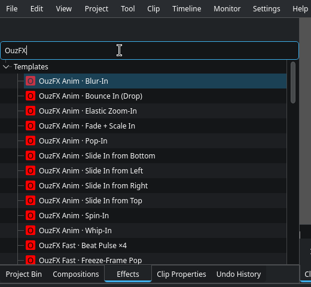 

## Install

### Linux (Arch, Debian/Ubuntu, Fedora…, native package, AppImage or Flatpak)

```bash
git clone https://github.com/AlfaPigeon/kdenlive-fx-pack.git && cd kdenlive-fx-pack && ./install.sh
```

or without git:

```bash
curl -L https://github.com/AlfaPigeon/kdenlive-fx-pack/archive/refs/heads/main.tar.gz | tar xz && kdenlive-fx-pack-main/install.sh
```

`install.sh` auto-detects native and Flatpak Kdenlive and installs into whichever exists:

| Kdenlive build | Data folder used |
|---|---|
| distro package / AppImage / self-built | `~/.local/share/kdenlive/` (`$XDG_DATA_HOME/kdenlive`) |
| Flatpak (`org.kde.kdenlive`) | `~/.var/app/org.kde.kdenlive/data/kdenlive/` |

Options: `--profile 1080p|4k|vertical` (match your project resolution, default 1080p), `--native`, `--flatpak`, `--both`,
`--list`, `--uninstall`, `--no-fonts`. **Restart Kdenlive** after installing. The installer also puts the three free brand
fonts (OFL) in `~/.local/share/fonts/ouzfx` so the label titles render correctly (`--no-fonts` skips that).

```bash
./install.sh --profile 4k        # 3840×2160 projects
./install.sh --profile vertical  # 1080×1920 Shorts / Reels / TikTok projects
./install.sh --uninstall         # remove everything (uses the install manifest)
```

### Windows

Download the release zip, extract it, then in PowerShell:

```powershell
powershell -ExecutionPolicy Bypass -File .\install.ps1            # or -Profile 4k / -Profile vertical
powershell -ExecutionPolicy Bypass -File .\install.ps1 -Uninstall
```

Manual copy: `pack\<profile>\effect-templates\*.xml` → `%AppData%\kdenlive\effect-templates\`,
`pack\<profile>\transitions\*.xml` → `%AppData%\kdenlive\transitions\` (replace `@LUMADIR@` with your lumas path),
`pack\lumas\HD\ouzfx` → `%LocalAppData%\kdenlive\lumas\HD\ouzfx`.

### Manual / any OS

| What | Copy from | Copy to (`<data>` = folder from the table above) |
|---|---|---|
| Effect templates | `pack/<profile>/effect-templates/*.xml` | `<data>/effect-templates/` |
| Compositions | `pack/<profile>/transitions/*.xml` (replace `@LUMADIR@` with `<data>/lumas`) | `<data>/transitions/` |
| Luma wipes | `pack/lumas/HD/ouzfx/`, `pack/lumas/VERTICAL/ouzfx/` | `<data>/lumas/HD/ouzfx/`, `<data>/lumas/VERTICAL/ouzfx/` |
| Highlight overlays | `highlights/1080/` (1080p & vertical) or `highlights/2160/` (4K) | `<data>/library/OuzFX Highlights/` (and/or anywhere) |
| Label title templates | `titles/<profile>/*.kdenlivetitle` | `<data>/titles/` |
| Brand fonts | `fonts/*.ttf` | `~/.local/share/fonts/` (Windows: double-click ▸ Install) |

### KDE Store / "Download New Effects"

Release assets include KDE-Store-ready archives (`ouzfx-effect-templates-*.tar.gz` for the *Kdenlive Effect Templates*
category and `ouzfx-luma-wipes-hd-*.tar.gz` for *Kdenlive FX* (lumas)). Once published there they can be installed from inside
Kdenlive via **Effects ▸ Download New Effects** / the Wipe method **Download** button. See [docs/KDE_STORE.md](docs/KDE_STORE.md).

## Requirements

* **Kdenlive 24.08 or newer** (easing keyframe types such as back/elastic/bounce). Kdenlive 25.04+ recommended.
* **Kdenlive 25.04+** for the *Perspective Screen* presets and `AFX_Util_Drop_Shadow_Polish` (they use the Drop Shadow
  effect added in 25.04; older Kdenlive silently hides those templates).
* Uses only effects that ship with Kdenlive: Transform (qtblend), Box Blur, Directional Blur, Gaussian Blur, Brightness,
  Crop/Rounded corners (qtcrop), Corners (frei0r), Drop Shadow, RGB Shift, Chroma Shift, Glitch0r, Scanlines, Grain,
  Dust, Colorize, Glow, Saturation, Greyscale, Vignette, Contrast, Pixelize, Alpha shapes (mask), and for audio: Low/High
  pass, Equalizer, Bitcrusher, Compensation Delay, Dynamic Loudness, Limiter. frei0r-based presets need the **frei0r-plugins** package, which
  Kdenlive depends on in Arch (`frei0r-plugins`), Debian/Ubuntu, Flatpak and the AppImage/Windows builds.

## How to use

* **Effect templates** (Effects ▸ Templates, or search `OuzFX`): drag onto a clip. Keyframes are anchored to the **start of
  the clip**, so razor (`Shift+R`) where the hit should happen and drop the preset on the right-hand piece. Each template
  lands as a small, editable effect stack (e.g. Transform + Box Blur) – tweak strength in the Effect Stack.
  Lengths are in frames (designed at 25/30 fps; at 50/60 fps everything is twice as snappy).
* **Compositions** (Compositions panel, search `OuzFX`): put the clip on V2 above the clip it should reveal, then drag the
  composition onto the overlap. Their keyframes use `0=` / `-1=` so they always span the whole composition – make it
  6–12 frames for whips and zoom-throughs, seconds for Ken Burns.
* **Audio templates** (`AFX_Audio_`): Effects ▸ Templates, drag onto an audio clip (or the audio part of an A/V clip).
* **Sound effects**: open the **Library** panel (View ▸ Library) ▸ *OuzFX SFX* ▸ risers / pops / whooshes / impacts and
  drag a file onto an audio track, or Project Bin ▸ **Add Clip** ▸ `<data>/ouzfx/sfx/`.
* **Luma wipes**: any Wipe composition or same-track mix (select two adjacent clips ▸ `U`) ▸ *Wipe Method* ▸ `ouzfx_*`.
* **Resolution**: Kdenlive's Transform widget only round-trips pixel rectangles (percentage rects are mis-read by the UI),
  so effect templates and compositions are generated per resolution – install the profile matching your project
  (`--profile 1080p|4k|vertical`). Durations/easing are identical across profiles.

## Fast-paced editing kit ⚡

Research summary (sources below) – what makes MrBeast / Ali Abdaal / tech-YouTube / TikTok edits feel fast, and the matching preset:

| Technique | Why it works | OuzFX preset |
|---|---|---|
| Zoom punch on the beat (100→115-130 %, ease-out) | hides jump cuts, adds rhythm | `Zoom · Punch-In 115%`, `Zoom · Punch In-Out (Beat)`, `Fast · Beat Pulse ×4` |
| "Zoom cut" wide→close (MrBeast) | instant reframing without new footage | `Fast · Zoom Cut (Hard 130%)` |
| Boom zoom / smash cut | emphasis on reveals and punchlines | `Zoom · Boom Zoom`, `Fast · Smash Cut In`, `Fast · Rush Zoom` |
| Shake on impact (a few frames, peak on the beat) | physical "hit" feeling | `Shake · Heavy Impact`, `Fast · Impact Hit`, `Text · Text Slam` |
| 1–2 frame white/black flash | masks a cut, resets the eye | `Stylize · Flash Frame (White)`, `Stylize · Dip Flash (Black)` |
| Whip pan / motion-blur slide (match direction) | seamless energetic scene change | `Trans · Whip Pan *`, `Anim · Whip-In`, `Fast · Motion-Blur Push Left` |
| RGB split / glitch hit | digital energy on drops | `Stylize · RGB Split Hit`, `Stylize · Digital Glitch Burst`, `Wipe · Glitch Blocks` |
| Freeze frame + pop | call out a moment ("this guy…") | `Fast · Freeze-Frame Pop` + Kdenlive freeze |
| Stress colour (MrBeast red moment) | emotional emphasis | `Stylize · Red Moment` |
| Text pop / kinetic typography | on-screen keywords on the exact line | `Text · Text Pop`, `Text Rise`, `Text Slam`, `Highlight Flash` |
| Screen-recording zoom to cursor | readable tutorials / code | `Screen Zoom · Zoom to …`, `Zoom Back Out` |
| Film burn / light leak | warm transition between segments | `Stylize · Film Burn Flash`, `Wipe · Film Burn Wipe`, `overlays/` clips |
| Speed ramps | slow-mo on the hit, fast through the build-up | Kdenlive **Time Remap** (Clip ▸ Time Remap): add 2 keyframes, drag the speed handle; pair with `Rush Zoom` |
| J / L cuts | audio leads/trails the picture – smoother talking-head cuts | split audio (`Ungroup` or `Alt`-drag), trim the audio clip past the video cut – no effect needed |

Rules of thumb from the sources: land every move on the beat, keep hits to a few frames, use one or two transition styles
per video, default to the hard cut, and remember retention comes from new information, not effects alone.


## Highlights · arrows, boxes, circles & labels (v1.3)

Animated highlights to point at things on screen, styled with the Ouz Labs brand kit ([docs/BRAND.md](docs/BRAND.md)):
**Signal Tangerine `#FF5A26`** by default, plus **Acid Volt `#C8FF2E`** and **Lab Chalk `#F4F4F0`** variants of the core shapes.
The style follows the kit: 12 px strokes, 16 px rounded frames, sticker badges with a 5 px Lab Chalk outline, and "elastic pops
meet mechanical clicks" timing. A soft Carbon Slate shadow keeps them readable on bright footage.

* **Pre-rendered alpha clips** (VP9 WebM with alpha, 30 fps) are generated by [`tools/make_highlights.py`](tools/make_highlights.py).
  They are **square** (1080×1080, or 2160×2160 for 4K), so the same file works in 16:9 and 9:16 projects. The **arrow tip / shape
  centre is the centre of the clip**.
* Every shape has three parts that cut together seamlessly:
  * `_in` – the entrance plus a 2 s idle.
  * `_loop` – a 2 s seamless idle (nudge, breathe, hand-drawn boil). Repeat it to hold the shape longer.
  * `_out` – the exit.
  * `click_ripple` is a single one-shot clip.
* **Label templates** use the brand fonts: JetBrains Mono tags, Plus Jakarta Sans callout text and a Bricolage Grotesque sticker.
  You type the label text, so there's nothing to re-render.

**How to use**

1. **Library panel** (View ▸ Library) ▸ *OuzFX Highlights* ▸ group ▸ drag `…_in_tangerine.webm` onto a track **above** your footage.
   Kdenlive composites tracks automatically, and the transparent parts show the footage underneath.
2. Select the clip ▸ add **Transform** (Effects ▸ search "Transform") and move / scale it so the **centre** sits on the object.
   For arrows, the **tip** is the centre.
3. Need it longer? Put `…_loop_…` right after the `_in` clip and repeat it as often as you need, then end with `…_out_…`.
   To drop a shape early, cut the `_in` clip anywhere and put the `_out` clip after it.
4. **Labels:** Project ▸ **Add Template Title…** ▸ pick an `ouzfx_*` template ▸ type the text in the *Text* box ▸ OK.
   To change it later, open **Clip Properties** ▸ first tab, edit the text and click **Apply**. To animate it, drop *Text Pop*,
   *Word Pop* or any OuzFX In/Out template on it. Pair `ouzfx_box_tag_*` with `box_draw_16x9`: they line up 1:1 in 1080p/vertical
   projects.

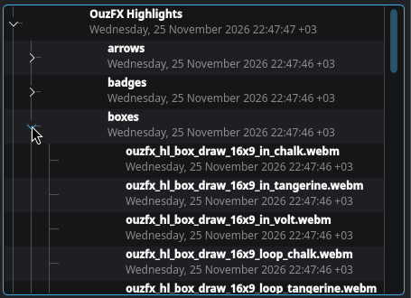 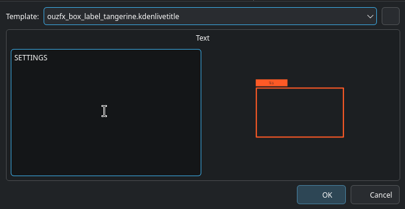

Tags fit about 10 characters, the corner lab tag about 22, and the sticker 3–5. For longer text, double-click the title clip
to open Kdenlive's Title editor and drag the pill wider. The default label colours are Carbon Slate text on Tangerine and Volt,
and Lab Chalk text on Cobalt and Slate.

At **25 fps** the clips keep their real-time speed (Kdenlive drops frames to match), so timing and seams stay the same.
At 50/60 fps they play at 30 fps motion. If a Kdenlive build ever shows a black square instead of transparency, run
`python3 tools/make_highlights.py --prores` for ProRes 4444 `.mov` fallbacks in `highlights-prores/`.

### Arrows

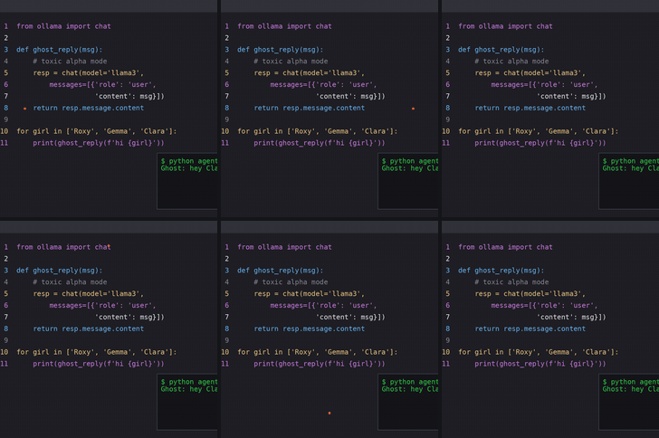

| Asset | Colours | Clips | Motion |
|---|---|---|---|
| `arrow_right` | tangerine, volt, chalk | in 13 f + 60 f idle · loop 60 f · out 9 f | straight arrow pointing right (tip = clip centre), draw-on + nudge |
| `arrow_left` | tangerine, volt, chalk | in 13 f + 60 f idle · loop 60 f · out 9 f | straight arrow pointing left (tip = clip centre), draw-on + nudge |
| `arrow_down` | tangerine, volt, chalk | in 13 f + 60 f idle · loop 60 f · out 9 f | straight arrow pointing down (tip = clip centre), draw-on + nudge |
| `arrow_up` | tangerine, volt, chalk | in 13 f + 60 f idle · loop 60 f · out 9 f | straight arrow pointing up (tip = clip centre), draw-on + nudge |
| `arrow_curved_down_right` | tangerine, volt, chalk | in 16 f + 60 f idle · loop 60 f · out 10 f | hand-drawn curved arrow pointing down-right (tip = clip centre) |
| `arrow_curved_down_left` | tangerine, volt, chalk | in 16 f + 60 f idle · loop 60 f · out 10 f | hand-drawn curved arrow pointing down-left (tip = clip centre) |

### Boxes & brackets

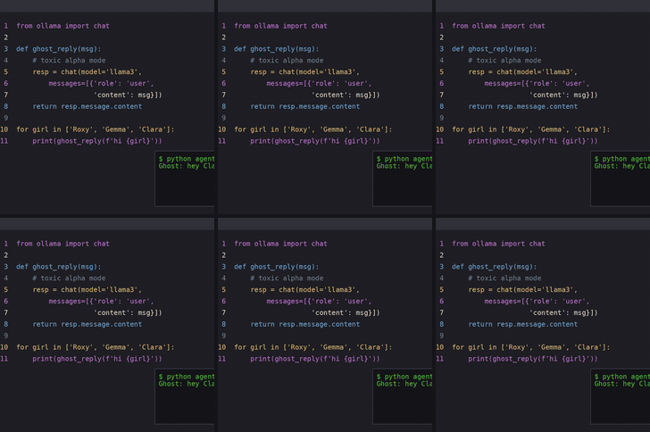

| Asset | Colours | Clips | Motion |
|---|---|---|---|
| `box_draw_16x9` | tangerine, volt, chalk | in 15 f + 60 f idle · loop 60 f · out 10 f | rounded outline box 880x495 (1080 ref), stroke draw-on |
| `box_draw_1x1` | tangerine | in 15 f + 60 f idle · loop 60 f · out 10 f | rounded outline box 560x560 (1080 ref), stroke draw-on |
| `box_draw_wide` | tangerine | in 15 f + 60 f idle · loop 60 f · out 10 f | rounded outline box 900x260 (1080 ref), stroke draw-on |
| `box_pop_16x9` | tangerine | in 11 f + 60 f idle · loop 60 f · out 8 f | rounded outline box 16:9, elastic scale-pop |
| `focus_brackets` | tangerine, volt, chalk | in 11 f + 60 f idle · loop 60 f · out 8 f | 4 corner brackets snap in around a 16:9 area |

### Circles & rings

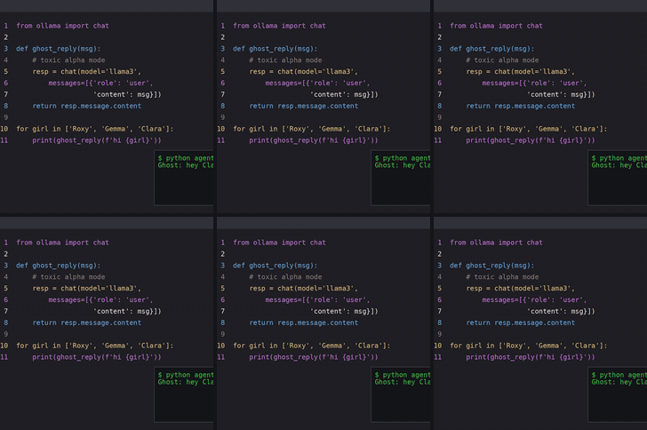

| Asset | Colours | Clips | Motion |
|---|---|---|---|
| `circle_draw` | tangerine, volt, chalk | in 15 f + 60 f idle · loop 60 f · out 10 f | circle outline, stroke draw-on |
| `ellipse_draw` | tangerine | in 15 f + 60 f idle · loop 60 f · out 10 f | wide ellipse outline, stroke draw-on |
| `circle_pop` | tangerine | in 11 f + 60 f idle · loop 60 f · out 8 f | circle outline, elastic scale-pop |
| `pulse_ring` | tangerine | in 11 f + 60 f idle · loop 60 f · out 8 f | circle with sonar pulse rings (loop) |

### Marks

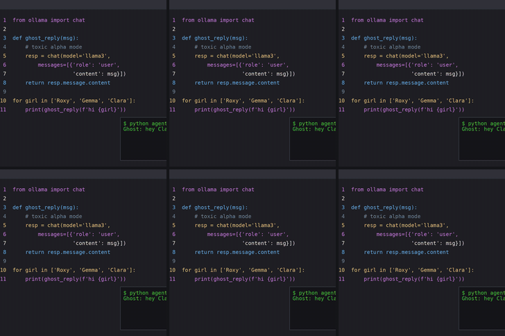

| Asset | Colours | Clips | Motion |
|---|---|---|---|
| `scribble_circle` | tangerine, volt, chalk | in 18 f + 60 f idle · loop 60 f · out 10 f | hand-drawn scribble loop around an object |
| `underline_swipe` | tangerine, volt, chalk | in 9 f + 60 f idle · loop 60 f · out 8 f | marker underline swipe (sits just below centre) |
| `check_draw` | tangerine, volt, chalk | in 12 f + 60 f idle · loop 60 f · out 8 f | check mark draw-on |
| `cross_draw` | tangerine, volt, chalk | in 12 f + 60 f idle · loop 60 f · out 8 f | cross (X) mark draw-on |

### Pointers

| Asset | Colours | Clips | Motion |
|---|---|---|---|
| `ping_dot` | tangerine | in 8 f + 60 f idle · loop 60 f · out 7 f | solid dot with ping ring (loop) |
| `click_ripple` | tangerine, volt, chalk | one-shot, 20 f | one-shot cursor click ripple (20 f) |

### Badges & stickers

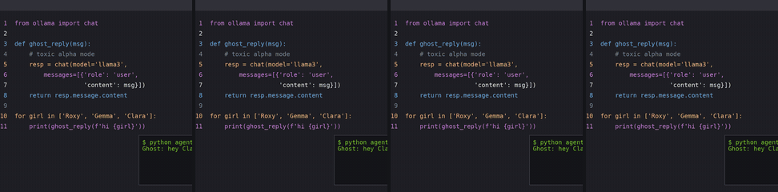

| Asset | Colours | Clips | Motion |
|---|---|---|---|
| `step_badge_01` | tangerine | in 11 f + 60 f idle · loop 60 f · out 8 f | numbered step badge 01 (JetBrains Mono) |
| `step_badge_02` | tangerine | in 11 f + 60 f idle · loop 60 f · out 8 f | numbered step badge 02 (JetBrains Mono) |
| `step_badge_03` | tangerine | in 11 f + 60 f idle · loop 60 f · out 8 f | numbered step badge 03 (JetBrains Mono) |
| `step_badge_04` | tangerine | in 11 f + 60 f idle · loop 60 f · out 8 f | numbered step badge 04 (JetBrains Mono) |
| `step_badge_05` | tangerine | in 11 f + 60 f idle · loop 60 f · out 8 f | numbered step badge 05 (JetBrains Mono) |
| `new_sticker` | volt | in 13 f + 60 f idle · loop 60 f · out 8 f | 'NEW' sticker cutout (Acid Volt, 5px Lab Chalk outline) |

### Label title templates (`titles/<profile>/`, installed to `<data>/titles/`)

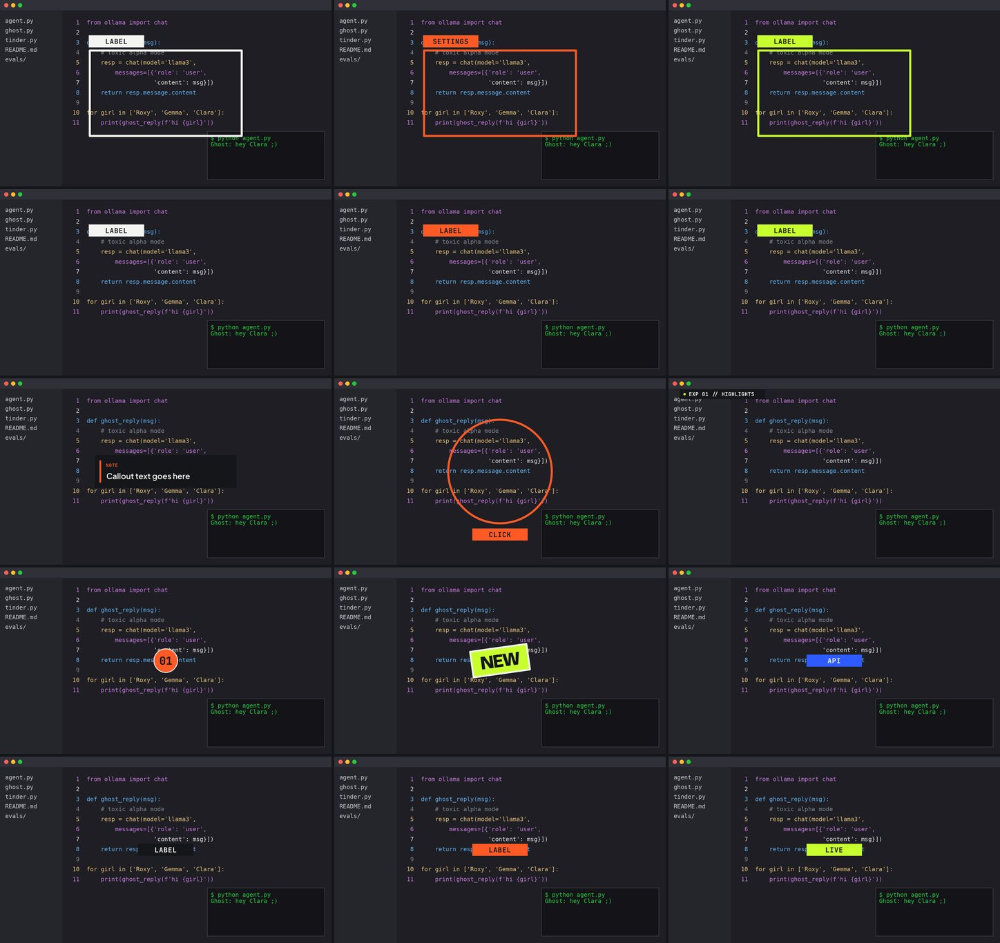

| Template | What it is |
|---|---|
| `ouzfx_tag_tangerine` | OuzFX Tag Tangerine |
| `ouzfx_tag_volt` | OuzFX Tag Volt |
| `ouzfx_tag_cobalt` | OuzFX Tag Cobalt |
| `ouzfx_tag_slate` | OuzFX Tag Slate |
| `ouzfx_box_tag_tangerine` | OuzFX Box Tag Tangerine (pairs with box_draw_16x9) |
| `ouzfx_box_label_tangerine` | OuzFX Box + Label Tangerine |
| `ouzfx_box_tag_volt` | OuzFX Box Tag Volt (pairs with box_draw_16x9) |
| `ouzfx_box_label_volt` | OuzFX Box + Label Volt |
| `ouzfx_box_tag_chalk` | OuzFX Box Tag Chalk (pairs with box_draw_16x9) |
| `ouzfx_box_label_chalk` | OuzFX Box + Label Chalk |
| `ouzfx_circle_label_tangerine` | OuzFX Circle + Label Tangerine |
| `ouzfx_step_badge` | OuzFX Step Badge (edit number) |
| `ouzfx_sticker_new` | OuzFX Sticker NEW (edit word) |
| `ouzfx_lab_tag_corner` | OuzFX Lab Tag Corner (series label) |
| `ouzfx_callout_note` | OuzFX Callout Note |

## The presets

⚡ = part of the fast-paced kit

The v1.0 categories come first, the v1.1 `AFX_*` additions after the luma table.

### Fast-Paced

| Preview | Name (search in Kdenlive) | What it does | Length |
|---|---|---|---|
| 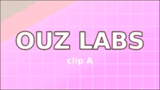 | **OuzFX Fast · Impact Hit (Shake + Flash + Zoom)** ⚡<br><sub>`ouzfx_fast_impact_hit` · effect template</sub> | All-in-one hit: 2-frame flash, 125% punch and a decaying shake (12 frames). Use on beat drops. | 12 f |
|  | **OuzFX Fast · Smash Cut In** ⚡<br><sub>`ouzfx_fast_smash_cut` · effect template</sub> | Starts at 140% with blur and slams to 100% in 4 frames – energetic hard cut entry. | 4 f |
|  | **OuzFX Fast · Zoom Cut (Hard 130%)** ⚡<br><sub>`ouzfx_fast_zoom_cut_hold` · effect template</sub> | Instant 130% reframe, no animation – the MrBeast wide→close 'zoom cut'. | static |
| 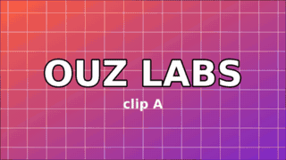 | **OuzFX Fast · Beat Pulse ×4** ⚡<br><sub>`ouzfx_fast_beat_pulse` · effect template</sub> | Four quick 108% pulses, one every 12 frames (≈120 BPM at 24 fps). Stretch keyframes to your tempo. | 48 f |
|  | **OuzFX Fast · Stutter Strobe** ⚡<br><sub>`ouzfx_fast_stutter_strobe` · effect template</sub> | 6-frame on/off brightness strobe – for glitchy, aggressive moments. | 6 f |
|  | **OuzFX Fast · Freeze-Frame Pop** ⚡<br><sub>`ouzfx_fast_freeze_pop` · effect template</sub> | Pair with Kdenlive's freeze (Timeline ▸ Insert Freeze Frame / Freeze effect): saturation boost, slight zoom and white flash so the still frame 'pops'. | 6 f |
|  | **OuzFX Fast · Motion-Blur Push Left** ⚡<br><sub>`ouzfx_fast_motion_slide_l` · effect template</sub> | Last 6 frames of a clip: whips the picture out to the left with heavy blur. Pair with 'Whip-In' on the next clip. | 6 f |
| 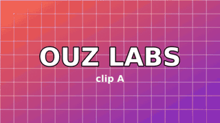 | **OuzFX Fast · Rush Zoom** ⚡<br><sub>`ouzfx_fast_speed_lines_zoom` · effect template</sub> | Accelerating zoom (100→160%) with growing blur over 8 frames – cut on the last frame. | 8 f |

### Camera Shake

| Preview | Name (search in Kdenlive) | What it does | Length |
|---|---|---|---|
|  | **OuzFX Shake · Handheld · Light**<br><sub>`ouzfx_shake_handheld_light` · effect template</sub> | Subtle, smooth handheld drift for 10 s (loopable feel). Great on static talking-head or screen footage. Trim/extend: keyframes stop at clip end. | 250 f |
|  | **OuzFX Shake · Micro Jitter**<br><sub>`ouzfx_shake_micro_jitter` · effect template</sub> | Barely-there high-frequency jitter (10 s) that makes locked-off shots feel alive. | 250 f |
|  | **OuzFX Shake · Heavy Impact** ⚡<br><sub>`ouzfx_shake_heavy_impact` · effect template</sub> | 20-frame violent hit that decays to rest, with motion blur on the first frames. Put the clip start on the impact / beat drop. | 20 f |
|  | **OuzFX Shake · Earthquake**<br><sub>`ouzfx_shake_earthquake` · effect template</sub> | 3 s of strong rumbling shake that slowly calms down, with light blur. | 75 f |
|  | **OuzFX Shake · Rotational**<br><sub>`ouzfx_shake_rotational` · effect template</sub> | Rocking rotational shake (30 frames, decaying) – feels like a punch to the camera. | 30 f |
|  | **OuzFX Shake · Walking Bounce**<br><sub>`ouzfx_shake_walk_bounce` · effect template</sub> | Vertical bob of a walking camera operator (10 s loop). | 240 f |

### Dynamic Zoom

| Preview | Name (search in Kdenlive) | What it does | Length |
|---|---|---|---|
| 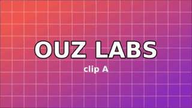 | **OuzFX Zoom · Punch-In 115%** ⚡<br><sub>`ouzfx_zoom_punch_in` · effect template</sub> | Snaps to 115% in 3 frames and holds – the classic jump-cut cover. | 3 f |
|  | **OuzFX Zoom · Punch In-Out (Beat)** ⚡<br><sub>`ouzfx_zoom_punch_in_out` · effect template</sub> | Zooms to 120% on frame 2 and settles back by frame 10. Drop one on every beat. | 10 f |
|  | **OuzFX Zoom · Boom Zoom** ⚡<br><sub>`ouzfx_zoom_boom` · effect template</sub> | Explosive 135% zoom with elastic settle at 112% (18 frames) – 'boom' moments. | 18 f |
| 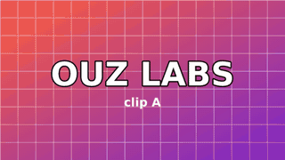 | **OuzFX Zoom · Zoom Bounce**<br><sub>`ouzfx_zoom_bounce` · effect template</sub> | Zooms from 100% to 125% with a bouncy landing (20 frames). | 20 f |
|  | **OuzFX Zoom · Slow Push-In (5 s)**<br><sub>`ouzfx_zoom_ken_burns_in` · effect template</sub> | Ken Burns style 100→112% push over 5 s (use the composition version to fit any length). | 125 f |
| 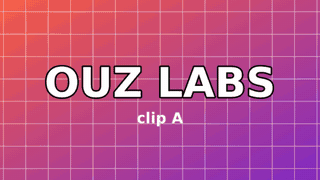 | **OuzFX Zoom · Slow Pull-Out (5 s)**<br><sub>`ouzfx_zoom_ken_burns_out` · effect template</sub> | Ken Burns style 112→100% pull-back over 5 s. | 125 f |

| Preview | Name (search in Kdenlive) | What it does | Length |
|---|---|---|---|
|  | **OuzFX Zoom · Ken Burns Push-In (Any Length)**<br><sub>`ouzfx_comp_ken_burns_in` · composition</sub> | 100→115% slow push that always spans the whole composition – stretch it over a photo/clip. | stretches |
| 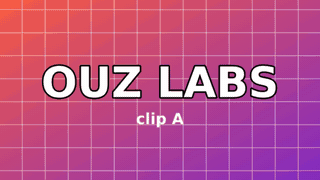 | **OuzFX Zoom · Ken Burns Pull-Out (Any Length)**<br><sub>`ouzfx_comp_ken_burns_out` · composition</sub> | 115→100% slow pull-back spanning the composition. | stretches |
|  | **OuzFX Zoom · Ken Burns Pan L→R (Any Length)**<br><sub>`ouzfx_comp_ken_burns_pan` · composition</sub> | Pans across a 120% image from left to right over the composition length. | stretches |

### Screen Zoom

| Preview | Name (search in Kdenlive) | What it does | Length |
|---|---|---|---|
|  | **OuzFX Screen Zoom · Zoom to Top-Left (Screen Rec)** ⚡<br><sub>`ouzfx_zoom_screen_tl` · effect template</sub> | Smooth 15-frame zoom to 180% on the top-left of a screen recording, then holds. Razor the clip where you want to zoom; move the rectangle in the monitor to aim at the cursor. | 15 f |
|  | **OuzFX Screen Zoom · Zoom to Top-Right (Screen Rec)** ⚡<br><sub>`ouzfx_zoom_screen_tr` · effect template</sub> | Smooth 15-frame zoom to 180% on the top-right of a screen recording, then holds. Razor the clip where you want to zoom; move the rectangle in the monitor to aim at the cursor. | 15 f |
|  | **OuzFX Screen Zoom · Zoom to Bottom-Left (Screen Rec)** ⚡<br><sub>`ouzfx_zoom_screen_bl` · effect template</sub> | Smooth 15-frame zoom to 180% on the bottom-left of a screen recording, then holds. Razor the clip where you want to zoom; move the rectangle in the monitor to aim at the cursor. | 15 f |
| 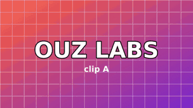 | **OuzFX Screen Zoom · Zoom to Bottom-Right (Screen Rec)** ⚡<br><sub>`ouzfx_zoom_screen_br` · effect template</sub> | Smooth 15-frame zoom to 180% on the bottom-right of a screen recording, then holds. Razor the clip where you want to zoom; move the rectangle in the monitor to aim at the cursor. | 15 f |
| 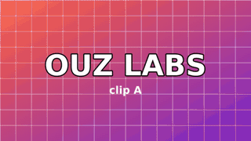 | **OuzFX Screen Zoom · Zoom to Center (Screen Rec)** ⚡<br><sub>`ouzfx_zoom_screen_c` · effect template</sub> | Smooth 15-frame zoom to 180% on the center of a screen recording, then holds. Razor the clip where you want to zoom; move the rectangle in the monitor to aim at the cursor. | 15 f |
| 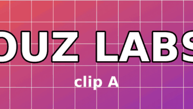 | **OuzFX Screen Zoom · Zoom Back Out (Screen Rec)**<br><sub>`ouzfx_zoom_screen_out` · effect template</sub> | Companion to the screen zooms: from 180% (center) back to full frame in 15 frames. | 15 f |

### Animations

| Preview | Name (search in Kdenlive) | What it does | Length |
|---|---|---|---|
|  | **OuzFX Anim · Pop-In**<br><sub>`ouzfx_anim_pop_in` · effect template</sub> | Scales from 0 to 100% with a back-overshoot in 12 frames. | 12 f |
|  | **OuzFX Anim · Slide In from Left**<br><sub>`ouzfx_anim_slide_in_left` · effect template</sub> | Slides in from the left edge in 12 frames (expo ease-out) with directional motion blur. | 12 f |
|  | **OuzFX Anim · Slide In from Right**<br><sub>`ouzfx_anim_slide_in_right` · effect template</sub> | Slides in from the right edge in 12 frames (expo ease-out) with directional motion blur. | 12 f |
|  | **OuzFX Anim · Slide In from Top**<br><sub>`ouzfx_anim_slide_in_top` · effect template</sub> | Slides in from the top edge in 12 frames (expo ease-out) with directional motion blur. | 12 f |
|  | **OuzFX Anim · Slide In from Bottom**<br><sub>`ouzfx_anim_slide_in_bottom` · effect template</sub> | Slides in from the bottom edge in 12 frames (expo ease-out) with directional motion blur. | 12 f |
|  | **OuzFX Anim · Bounce In (Drop)**<br><sub>`ouzfx_anim_bounce_in` · effect template</sub> | Drops from above and bounces on the floor (20 frames). | 20 f |
|  | **OuzFX Anim · Spin-In**<br><sub>`ouzfx_anim_spin_in` · effect template</sub> | Spins 360° while scaling from 0 to 100% (15 frames, cubic ease-out). | 15 f |
|  | **OuzFX Anim · Fade + Scale In**<br><sub>`ouzfx_anim_fade_scale_in` · effect template</sub> | Gentle 92→100% scale with fade-in over 15 frames – clean Apple-style reveal. | 15 f |
| 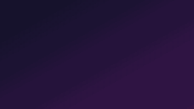 | **OuzFX Anim · Whip-In** ⚡<br><sub>`ouzfx_anim_whip_in` · effect template</sub> | Very fast slide from the right with heavy motion blur (6 frames). | 6 f |
|  | **OuzFX Anim · Elastic Zoom-In**<br><sub>`ouzfx_anim_elastic_in` · effect template</sub> | Springs in from 40% to 100% with an elastic wobble (20 frames). | 20 f |
|  | **OuzFX Anim · Blur-In**<br><sub>`ouzfx_anim_blur_in` · effect template</sub> | Starts heavily blurred and transparent, resolves to sharp in 15 frames. | 15 f |

| Preview | Name (search in Kdenlive) | What it does | Length |
|---|---|---|---|
| 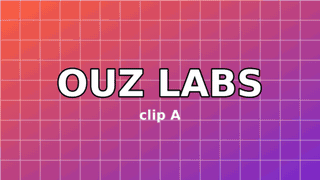 | **OuzFX Anim · Slide Out Left**<br><sub>`ouzfx_comp_slide_out_left` · composition</sub> | Top clip exits to the left (expo ease-in). Place it over the END of the clip. | stretches |
|  | **OuzFX Anim · Slide Out Right**<br><sub>`ouzfx_comp_slide_out_right` · composition</sub> | Top clip exits to the right (expo ease-in). Place it over the END of the clip. | stretches |
|  | **OuzFX Anim · Slide Out Up**<br><sub>`ouzfx_comp_slide_out_up` · composition</sub> | Top clip exits to the up (expo ease-in). Place it over the END of the clip. | stretches |
|  | **OuzFX Anim · Slide Out Down**<br><sub>`ouzfx_comp_slide_out_down` · composition</sub> | Top clip exits to the down (expo ease-in). Place it over the END of the clip. | stretches |
| 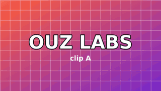 | **OuzFX Anim · Pop Out**<br><sub>`ouzfx_comp_pop_out` · composition</sub> | Anticipates (MLT back ease-in: grows to ≈ 137%) then collapses to 0% – place over the end of a clip/title. | stretches |
| 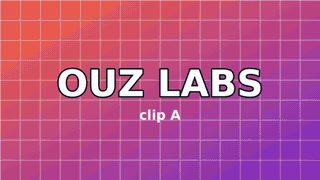 | **OuzFX Anim · Fade + Scale Out**<br><sub>`ouzfx_comp_fade_scale_out` · composition</sub> | Soft 100→92% shrink with fade-out. | stretches |
|  | **OuzFX Anim · Pop In (Any Length)**<br><sub>`ouzfx_comp_pop_in` · composition</sub> | Back-overshoot pop-in that stretches to the composition length. | stretches |

### Perspective Screen

| Preview | Name (search in Kdenlive) | What it does | Length |
|---|---|---|---|
| 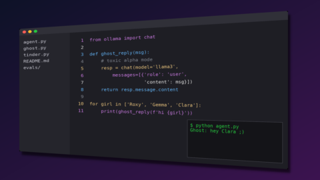 | **OuzFX Screen 3D · Tilt Left**<br><sub>`ouzfx_screen_tilt_left` · effect template</sub> | Screen recording turned into a 3D panel facing left: rounded corners, perspective and a soft drop shadow. Put a background on the track below. | static |
|  | **OuzFX Screen 3D · Tilt Right**<br><sub>`ouzfx_screen_tilt_right` · effect template</sub> | Mirror of Tilt Left – panel facing right. | static |
| 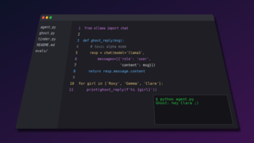 | **OuzFX Screen 3D · Laptop Lean**<br><sub>`ouzfx_screen_tilt_back` · effect template</sub> | Panel leaning back like a laptop screen seen from the desk. | static |
| 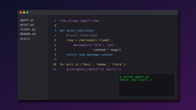 | **OuzFX Screen 3D · Floating Screen (Flat)**<br><sub>`ouzfx_screen_floating` · effect template</sub> | Flat floating window: rounded corners, 82% scale, big soft shadow. | static |
|  | **OuzFX Screen 3D · Swing to Front**<br><sub>`ouzfx_screen_tilt_to_flat` · effect template</sub> | Starts tilted left and swings to a flat, centred panel in 25 frames – nice opener for a demo. | 25 f |
|  | **OuzFX Screen 3D · Floating Screen · Pop In**<br><sub>`ouzfx_screen_pop_in` · effect template</sub> | Floating window pops in from 40% with overshoot (18 frames), rounded + shadow. | 18 f |

| Preview | Name (search in Kdenlive) | What it does | Length |
|---|---|---|---|
|  | **OuzFX Screen 3D · Picture-in-Picture Corner (Pop)**<br><sub>`ouzfx_comp_picture_in_picture` · composition</sub> | Webcam/facecam bubble: pops into the bottom-right corner at 30% size. | stretches |

### Transitions

| Preview | Name (search in Kdenlive) | What it does | Length |
|---|---|---|---|
|  | **OuzFX Trans · Zoom-Through In** ⚡<br><sub>`ouzfx_comp_zoom_through_in` · composition</sub> | Top clip flies in from 300% (transparent) to full frame – put it over the end of the lower clip. | stretches |
|  | **OuzFX Trans · Zoom-Through Out** ⚡<br><sub>`ouzfx_comp_zoom_through_out` · composition</sub> | Top clip rushes towards the camera (100→300%) and fades, revealing the clip below. | stretches |
|  | **OuzFX Trans · Shrink Away**<br><sub>`ouzfx_comp_zoom_out_reveal` · composition</sub> | Top clip shrinks to nothing in the centre, revealing the lower track. | stretches |
|  | **OuzFX Trans · Whip Pan Left** ⚡<br><sub>`ouzfx_comp_whip_left` · composition</sub> | Top clip enters from the opposite side and whips left into place with strong ease-out (add a dblur/boxblur for extra smear). Keep it 6–10 frames. | stretches |
| 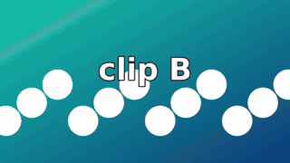 | **OuzFX Trans · Whip Pan Right** ⚡<br><sub>`ouzfx_comp_whip_right` · composition</sub> | Top clip enters from the opposite side and whips right into place with strong ease-out (add a dblur/boxblur for extra smear). Keep it 6–10 frames. | stretches |
|  | **OuzFX Trans · Whip Pan Up** ⚡<br><sub>`ouzfx_comp_whip_up` · composition</sub> | Top clip enters from the opposite side and whips up into place with strong ease-out (add a dblur/boxblur for extra smear). Keep it 6–10 frames. | stretches |
|  | **OuzFX Trans · Whip Pan Down** ⚡<br><sub>`ouzfx_comp_whip_down` · composition</sub> | Top clip enters from the opposite side and whips down into place with strong ease-out (add a dblur/boxblur for extra smear). Keep it 6–10 frames. | stretches |
|  | **OuzFX Trans · Spin In** ⚡<br><sub>`ouzfx_comp_spin_in` · composition</sub> | Top clip spins in 360° from 0% – fun, high-energy reveal. | stretches |
|  | **OuzFX Trans · Spin Out**<br><sub>`ouzfx_comp_spin_out` · composition</sub> | Top clip spins away 360° shrinking to 0%. | stretches |

### Glitch & Stylize

| Preview | Name (search in Kdenlive) | What it does | Length |
|---|---|---|---|
|  | **OuzFX Stylize · RGB Split Hit** ⚡<br><sub>`ouzfx_glitch_rgb_split_hit` · effect template</sub> | 8-frame chromatic split that kicks hard and snaps back – sync to a beat or a cut. | 8 f |
|  | **OuzFX Stylize · Digital Glitch Burst** ⚡<br><sub>`ouzfx_glitch_digital_burst` · effect template</sub> | 12 frames of block glitching + RGB tearing that fades out. | 12 f |
| 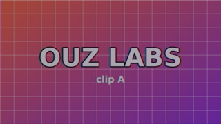 | **OuzFX Stylize · VHS Tape**<br><sub>`ouzfx_style_vhs` · effect template</sub> | Scanlines, chroma bleed, soft blur, noise and slightly washed colour – instant 90s tape. | static |
|  | **OuzFX Stylize · Flash Frame (White)** ⚡<br><sub>`ouzfx_flash_white` · effect template</sub> | 2-frame white flash that fades by frame 6 – hides a cut and adds punch. | 6 f |
|  | **OuzFX Stylize · Dip Flash (Black)** ⚡<br><sub>`ouzfx_flash_black` · effect template</sub> | Quick dip to black and back in 6 frames. | 6 f |
|  | **OuzFX Stylize · Film Burn Flash** ⚡<br><sub>`ouzfx_style_film_burn` · effect template</sub> | Warm orange over-exposure with glow that peaks at frame 6 and clears by 16. | 16 f |
| 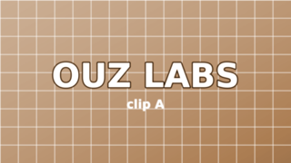 | **OuzFX Stylize · Warm Light Leak Look**<br><sub>`ouzfx_style_light_leak` · effect template</sub> | Soft warm glow and lifted highlights (static look). For moving leaks, also drop overlays/ouzfx_light_leak.mp4 on a track above with Screen blend. | static |
| 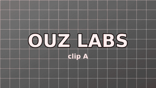 | **OuzFX Stylize · Red Moment** ⚡<br><sub>`ouzfx_style_red_alert` · effect template</sub> | MrBeast-style 'stress' tint: flash to deep red with a small punch (hold 1–2 s). | 4 f |
|  | **OuzFX Stylize · B&W Flashback**<br><sub>`ouzfx_style_flashback` · effect template</sub> | Black & white, grain, vignette and old-film flicker for flashbacks / archive footage. | static |

### Text & Titles

| Preview | Name (search in Kdenlive) | What it does | Length |
|---|---|---|---|
|  | **OuzFX Text · Text Pop** ⚡<br><sub>`ouzfx_text_pop` · effect template</sub> | For title clips: pops in with a back overshoot in 8 frames (kinetic typography staple). | 8 f |
|  | **OuzFX Text · Text Slam** ⚡<br><sub>`ouzfx_text_slam` · effect template</sub> | Title slams down from 300% and the frame shakes on landing (14 frames). | 14 f |
| 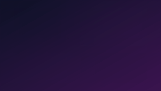 | **OuzFX Text · Text Rise**<br><sub>`ouzfx_text_rise` · effect template</sub> | Rises 6% and fades in over 12 frames – clean lower-third / callout entry. | 12 f |
|  | **OuzFX Text · Text Wiggle (Loop)**<br><sub>`ouzfx_text_wiggle` · effect template</sub> | Playful ±3° wiggle and 2% breathe for 4 s – for stickers, arrows, emojis. | 100 f |
| 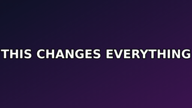 | **OuzFX Text · Highlight Flash**<br><sub>`ouzfx_text_typewriter_flash` · effect template</sub> | Draws attention to a callout: brightness flash + 110% pulse (10 frames). | 10 f |

### Overlays

| Preview | Name (search in Kdenlive) | What it does | Length |
|---|---|---|---|
| 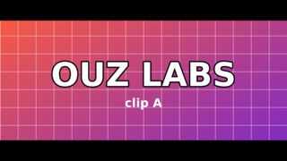 | **OuzFX Look · Cinematic 2.39:1 Bars + Vignette**<br><sub>`ouzfx_look_cinematic_239` · effect template</sub> | Letterbox bars for a 2.39:1 look plus a soft vignette. | static |
| 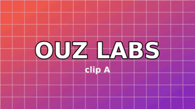 | **OuzFX Look · Cinematic Bars Slide-In**<br><sub>`ouzfx_look_bars_slide_in` · effect template</sub> | 2.39:1 letterbox bars glide in over 15 frames – 'movie moment' / dramatic beat. | 15 f |
|  | **OuzFX Look · Film Grain + Dust**<br><sub>`ouzfx_look_film_grain` · effect template</sub> | Organic grain with a few dust specks – makes digital footage feel shot on film. | static |
|  | **OuzFX Look · Soft Vignette**<br><sub>`ouzfx_look_soft_vignette` · effect template</sub> | Gentle edge darkening that pulls the eye to the centre. | static |

### Luma Wipes

| Preview | Name (search in Kdenlive) | What it does | Length |
|---|---|---|---|
|  | **OuzFX Wipe · Film Burn Wipe**<br><sub>`ouzfx_comp_wipe_burn` · composition</sub> | Wipe composition using the bundled ouzfx_burn.png luma (softness 0.25). The same luma is also selectable in every Wipe/Luma transition and same-track mix. | stretches |
|  | **OuzFX Wipe · Glitch Blocks Wipe** ⚡<br><sub>`ouzfx_comp_wipe_glitch` · composition</sub> | Wipe composition using the bundled ouzfx_glitch_blocks.png luma (softness 0.0). The same luma is also selectable in every Wipe/Luma transition and same-track mix. | stretches |
|  | **OuzFX Wipe · Diamond Wipe**<br><sub>`ouzfx_comp_wipe_diamond` · composition</sub> | Wipe composition using the bundled ouzfx_diamond.png luma (softness 0.08). The same luma is also selectable in every Wipe/Luma transition and same-track mix. | stretches |
|  | **OuzFX Wipe · Clock Wipe**<br><sub>`ouzfx_comp_wipe_clock` · composition</sub> | Wipe composition using the bundled ouzfx_clock.png luma (softness 0.04). The same luma is also selectable in every Wipe/Luma transition and same-track mix. | stretches |
|  | **OuzFX Wipe · Iris Wipe**<br><sub>`ouzfx_comp_wipe_iris` · composition</sub> | Wipe composition using the bundled ouzfx_radial.png luma (softness 0.1). The same luma is also selectable in every Wipe/Luma transition and same-track mix. | stretches |

### Luma wipe images

| Preview | File | Shape |
|---|---|---|
|  | `ouzfx_radial.png` | Iris / radial from centre |
|  | `ouzfx_radial_soft.png` | Soft round spotlight |
|  | `ouzfx_diagonal_tl.png` | Diagonal from top-left |
|  | `ouzfx_diagonal_tr.png` | Diagonal from top-right |
|  | `ouzfx_clock.png` | Clock sweep from 12 o'clock |
|  | `ouzfx_blinds_h.png` | Horizontal blinds (8 slats) |
|  | `ouzfx_blinds_v.png` | Vertical blinds (12 slats) |
|  | `ouzfx_diamond.png` | Diamond from centre |
|  | `ouzfx_burn.png` | Organic film-burn noise |
|  | `ouzfx_glitch_blocks.png` | Random glitch blocks |
|  | `ouzfx_zigzag.png` | Zig-zag teeth from left |
| 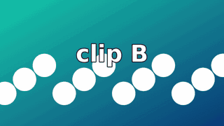 | `ouzfx_barn_doors.png` | Barn doors opening from centre |
|  | `ouzfx_spiral.png` | Spiral from centre |
|  | `ouzfx_heart.png` | Heart iris (for fun edits) |
| 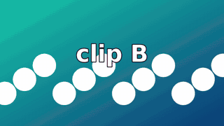 | `ouzfx_pixel_dissolve.png` | Pixel dissolve (32px cells) |
|  | `ouzfx_swipe_up_soft.png` | Soft swipe upwards |

### AFX_Move · object & text movement (v1.1)

| Preview | Name (search in Kdenlive) | What it does | Length |
|---|---|---|---|
| 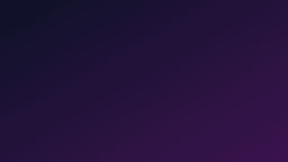 | **OuzFX AFX_Move_Overshoot_Slide_In_Left** ⚡<br><sub>`ouzfx_afx_move_overshoot_slide_in_left` · effect template</sub> | Slides in from the left edge, swings past its resting spot and settles back (14 frames, Kdenlive/MLT back ease-out – the overshoot peaks at ≈ 37% of the travel) with a short motion-blur peak. | 14 f |
| 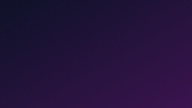 | **OuzFX AFX_Move_Overshoot_Slide_In_Right** ⚡<br><sub>`ouzfx_afx_move_overshoot_slide_in_right` · effect template</sub> | Slides in from the right edge, swings past its resting spot and settles back (14 frames, Kdenlive/MLT back ease-out – the overshoot peaks at ≈ 37% of the travel) with a short motion-blur peak. | 14 f |
|  | **OuzFX AFX_Move_Overshoot_Slide_In_Top** ⚡<br><sub>`ouzfx_afx_move_overshoot_slide_in_top` · effect template</sub> | Slides in from the top edge, swings past its resting spot and settles back (14 frames, Kdenlive/MLT back ease-out – the overshoot peaks at ≈ 37% of the travel) with a short motion-blur peak. | 14 f |
| 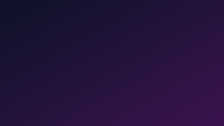 | **OuzFX AFX_Move_Overshoot_Slide_In_Bottom** ⚡<br><sub>`ouzfx_afx_move_overshoot_slide_in_bottom` · effect template</sub> | Slides in from the bottom edge, swings past its resting spot and settles back (14 frames, Kdenlive/MLT back ease-out – the overshoot peaks at ≈ 37% of the travel) with a short motion-blur peak. | 14 f |
|  | **OuzFX AFX_Move_Masked_Edge_Reveal_Up**<br><sub>`ouzfx_afx_move_masked_edge_reveal_up` · effect template</sub> | Emerges up out of an invisible line through the middle of the frame: the layer slides while a static crop keeps only the upper half visible (15 frames, expo ease-out). Made for split graphics / callout cards – move the Crop rectangle to put the line anywhere. | 15 f |
|  | **OuzFX AFX_Move_Masked_Edge_Reveal_Down**<br><sub>`ouzfx_afx_move_masked_edge_reveal_down` · effect template</sub> | Emerges down out of an invisible line through the middle of the frame: the layer slides while a static crop keeps only the lower half visible (15 frames, expo ease-out). Made for split graphics / callout cards – move the Crop rectangle to put the line anywhere. | 15 f |
|  | **OuzFX AFX_Move_Masked_Edge_Reveal_Left**<br><sub>`ouzfx_afx_move_masked_edge_reveal_left` · effect template</sub> | Emerges left out of an invisible line through the middle of the frame: the layer slides while a static crop keeps only the left half visible (15 frames, expo ease-out). Made for split graphics / callout cards – move the Crop rectangle to put the line anywhere. | 15 f |
|  | **OuzFX AFX_Move_Masked_Edge_Reveal_Right**<br><sub>`ouzfx_afx_move_masked_edge_reveal_right` · effect template</sub> | Emerges right out of an invisible line through the middle of the frame: the layer slides while a static crop keeps only the right half visible (15 frames, expo ease-out). Made for split graphics / callout cards – move the Crop rectangle to put the line anywhere. | 15 f |
|  | **OuzFX AFX_Move_Idle_Float_Gentle**<br><sub>`ouzfx_afx_move_idle_float_gentle` · effect template</sub> | Continuous hover for static PNGs/screenshots: ±1% vertical bob with ±1.2° sway (sine, 200 frames ≈ 8 s, loops seamlessly – extend by copying keyframes). | 200 f |
|  | **OuzFX AFX_Move_Idle_Float_Strong**<br><sub>`ouzfx_afx_move_idle_float_strong` · effect template</sub> | Continuous hover for static PNGs/screenshots: ±2% vertical bob with ±2° sway (sine, 160 frames ≈ 6.4 s, loops seamlessly – extend by copying keyframes). | 160 f |
| 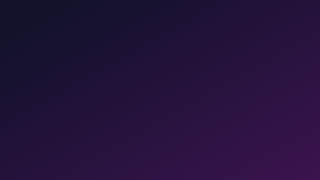 | **OuzFX AFX_Move_Card_3D_Swing_In_Left**<br><sub>`ouzfx_afx_move_card_3d_swing_in_left` · effect template</sub> | Tweet / document / card swings in from the left in 3D perspective and flattens to face the viewer (18 frames, cubic ease-out). Uses the Corners effect; works without Drop Shadow (any 24.08+). | 18 f |
| 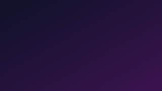 | **OuzFX AFX_Move_Card_3D_Swing_In_Right**<br><sub>`ouzfx_afx_move_card_3d_swing_in_right` · effect template</sub> | Tweet / document / card swings in from the right in 3D perspective and flattens to face the viewer (18 frames, cubic ease-out). Uses the Corners effect; works without Drop Shadow (any 24.08+). | 18 f |
| 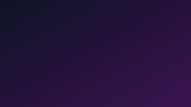 | **OuzFX AFX_Move_Hinge_Swing_In_Top_Left**<br><sub>`ouzfx_afx_move_hinge_swing_in_top_left` · effect template</sub> | Swings down into frame around its top-left corner like a sign on a hinge, then settles with a small decaying swing (24 frames). | 24 f |
| 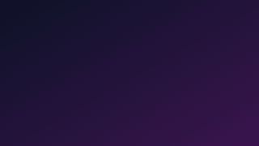 | **OuzFX AFX_Move_Hinge_Swing_In_Top_Right**<br><sub>`ouzfx_afx_move_hinge_swing_in_top_right` · effect template</sub> | Mirror of Hinge Swing-In Top-Left – pivots around the top-right corner. | 24 f |
|  | **OuzFX AFX_Move_Pendulum_Swing_Settle**<br><sub>`ouzfx_afx_move_pendulum_swing_settle` · effect template</sub> | Hangs from the top-centre and swings like a pendulum (±25°, decaying over 36 frames) – hanging signs, price tags, name cards. | 36 f |
|  | **OuzFX AFX_Move_PiP_Snap_Top_Left**<br><sub>`ouzfx_afx_move_pip_snap_top_left` · effect template</sub> | Shrinks a full-screen clip to a 32% picture-in-picture and snaps it into the top-left corner with rounded edges (12 frames, cubic ease-out). For a border/shadow add 'OuzFX AFX_Util_Drop_Shadow_Polish' after it. | 12 f |
| 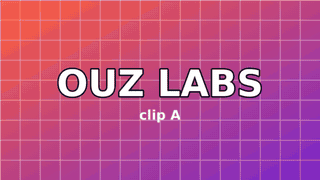 | **OuzFX AFX_Move_PiP_Snap_Top_Right**<br><sub>`ouzfx_afx_move_pip_snap_top_right` · effect template</sub> | Shrinks a full-screen clip to a 32% picture-in-picture and snaps it into the top-right corner with rounded edges (12 frames, cubic ease-out). For a border/shadow add 'OuzFX AFX_Util_Drop_Shadow_Polish' after it. | 12 f |
| 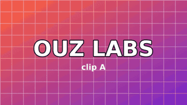 | **OuzFX AFX_Move_PiP_Snap_Bottom_Left**<br><sub>`ouzfx_afx_move_pip_snap_bottom_left` · effect template</sub> | Shrinks a full-screen clip to a 32% picture-in-picture and snaps it into the bottom-left corner with rounded edges (12 frames, cubic ease-out). For a border/shadow add 'OuzFX AFX_Util_Drop_Shadow_Polish' after it. | 12 f |
| 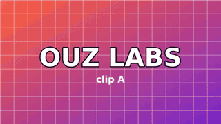 | **OuzFX AFX_Move_PiP_Snap_Bottom_Right**<br><sub>`ouzfx_afx_move_pip_snap_bottom_right` · effect template</sub> | Shrinks a full-screen clip to a 32% picture-in-picture and snaps it into the bottom-right corner with rounded edges (12 frames, cubic ease-out). For a border/shadow add 'OuzFX AFX_Util_Drop_Shadow_Polish' after it. | 12 f |
| 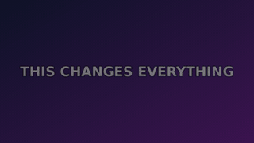 | **OuzFX AFX_Move_Text_Word_Pop_Shorts** ⚡<br><sub>`ouzfx_afx_move_text_word_pop_shorts` · effect template</sub> | TikTok/Reels/Shorts caption pop: 85% → 105% → 100% in 4 frames. Faster and subtler than 'Text · Text Pop' – drop it on every caption clip. | 4 f |
| 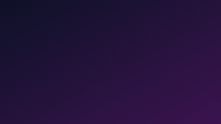 | **OuzFX AFX_Move_Text_Typewriter_Wipe_Fast**<br><sub>`ouzfx_afx_move_text_typewriter_wipe_fast` · effect template</sub> | Linear left-to-right crop reveal that uncovers a line of text over 25 frames (1 s @25 fps). Put it on a title clip; drag the last keyframe to change the speed. | 25 f |
| 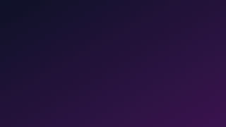 | **OuzFX AFX_Move_Text_Typewriter_Wipe_Slow**<br><sub>`ouzfx_afx_move_text_typewriter_wipe_slow` · effect template</sub> | Linear left-to-right crop reveal that uncovers a line of text over 50 frames (2 s @25 fps). Put it on a title clip; drag the last keyframe to change the speed. | 50 f |
| 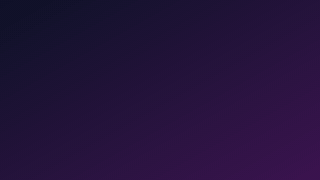 | **OuzFX AFX_Move_Text_Glitch_In** ⚡<br><sub>`ouzfx_afx_move_text_glitch_in` · effect template</sub> | Title flickers on: erratic opacity drops, tiny horizontal jitter and RGB tearing over the first 6 frames, then locks steady. | 6 f |


### AFX_Cam · camera & framing (v1.1)

| Preview | Name (search in Kdenlive) | What it does | Length |
|---|---|---|---|
|  | **OuzFX AFX_Cam_Impact_Shake_Light** ⚡<br><sub>`ouzfx_afx_cam_impact_shake_light` · effect template</sub> | Light decaying X/Y + rotational jitter (10 frames) for bass hits, desk slams and small impacts. Heavy tier = 'Shake · Heavy Impact'. | 10 f |
|  | **OuzFX AFX_Cam_Impact_Shake_Medium** ⚡<br><sub>`ouzfx_afx_cam_impact_shake_medium` · effect template</sub> | Medium decaying X/Y + rotational jitter (15 frames) for bass hits, desk slams and small impacts. Heavy tier = 'Shake · Heavy Impact'. | 15 f |
|  | **OuzFX AFX_Cam_Whip_Pan_Push_Right** ⚡<br><sub>`ouzfx_afx_cam_whip_pan_push_right` · effect template</sub> | Last 8 frames of a clip: whips the picture out right with heavy directional blur. Razor 8 frames before the cut and drop it on the right-hand piece (left version = 'Fast · Motion-Blur Push Left'). | 8 f |
|  | **OuzFX AFX_Cam_Whip_Pan_Push_Up** ⚡<br><sub>`ouzfx_afx_cam_whip_pan_push_up` · effect template</sub> | Last 8 frames of a clip: whips the picture out up with heavy directional blur. Razor 8 frames before the cut and drop it on the right-hand piece (left version = 'Fast · Motion-Blur Push Left'). | 8 f |
|  | **OuzFX AFX_Cam_Whip_Pan_Push_Down** ⚡<br><sub>`ouzfx_afx_cam_whip_pan_push_down` · effect template</sub> | Last 8 frames of a clip: whips the picture out down with heavy directional blur. Razor 8 frames before the cut and drop it on the right-hand piece (left version = 'Fast · Motion-Blur Push Left'). | 8 f |
|  | **OuzFX AFX_Cam_Heartbeat_Pulse**<br><sub>`ouzfx_afx_cam_heartbeat_pulse` · effect template</sub> | Two 'lub-dub' heartbeats (≈ 70 BPM, 72 frames): a small 103.5% swell, a bigger 105% one, with a matching darkening throb. Builds tension; copy keyframes to extend. | 72 f |
|  | **OuzFX AFX_Cam_Dutch_Angle_Subtle_8deg**<br><sub>`ouzfx_afx_cam_dutch_angle_subtle_8deg` · effect template</sub> | Eases the horizon to a 8° Dutch angle over 20 frames and holds, auto-zooming just enough (124%) that no black corners show. Suspense / confusion / surreal beats. | 20 f |
|  | **OuzFX AFX_Cam_Dutch_Angle_Strong_15deg**<br><sub>`ouzfx_afx_cam_dutch_angle_strong_15deg` · effect template</sub> | Eases the horizon to a 15° Dutch angle over 20 frames and holds, auto-zooming just enough (143%) that no black corners show. Suspense / confusion / surreal beats. | 20 f |
|  | **OuzFX AFX_Cam_Zoom_Callout_Return_Top_Left**<br><sub>`ouzfx_afx_cam_zoom_callout_return_top_left` · effect template</sub> | Return half of the callout: from the 180% top-left zoom (Screen Zoom · Zoom to Top-Left) smoothly back to 100% in 15 frames. Razor where the callout ends. | 15 f |
|  | **OuzFX AFX_Cam_Zoom_Callout_Return_Top_Right**<br><sub>`ouzfx_afx_cam_zoom_callout_return_top_right` · effect template</sub> | Return half of the callout: from the 180% top-right zoom (Screen Zoom · Zoom to Top-Right) smoothly back to 100% in 15 frames. Razor where the callout ends. | 15 f |
|  | **OuzFX AFX_Cam_Zoom_Callout_Return_Bottom_Left**<br><sub>`ouzfx_afx_cam_zoom_callout_return_bottom_left` · effect template</sub> | Return half of the callout: from the 180% bottom-left zoom (Screen Zoom · Zoom to Bottom-Left) smoothly back to 100% in 15 frames. Razor where the callout ends. | 15 f |
|  | **OuzFX AFX_Cam_Zoom_Callout_Return_Bottom_Right**<br><sub>`ouzfx_afx_cam_zoom_callout_return_bottom_right` · effect template</sub> | Return half of the callout: from the 180% bottom-right zoom (Screen Zoom · Zoom to Bottom-Right) smoothly back to 100% in 15 frames. Razor where the callout ends. | 15 f |
|  | **OuzFX AFX_Cam_Cinematic_Bars_Slide_Out**<br><sub>`ouzfx_afx_cam_cinematic_bars_slide_out` · effect template</sub> | Out half of the letterbox: 2.39:1 bars retract over 15 frames, leaving 'movie mode'. Pair with 'Look · Cinematic Bars Slide-In'. | 15 f |

| Preview | Name (search in Kdenlive) | What it does | Length |
|---|---|---|---|
|  | **OuzFX AFX_Cam_Ken_Burns_Pan_Right_to_Left**<br><sub>`ouzfx_afx_cam_ken_burns_pan_right_to_left` · composition</sub> | Pans across a 120% image from right to left over the whole composition length (companion of Pan L→R). | stretches |
|  | **OuzFX AFX_Cam_Ken_Burns_Pan_Up**<br><sub>`ouzfx_afx_cam_ken_burns_pan_up` · composition</sub> | Tilts up across a 120% image (bottom → top) over the composition length – tall photos, buildings. | stretches |
|  | **OuzFX AFX_Cam_Ken_Burns_Pan_Down**<br><sub>`ouzfx_afx_cam_ken_burns_pan_down` · composition</sub> | Tilts down across a 120% image (top → bottom) over the composition length. | stretches |


### AFX_Util · focus, callout & explainer utilities (v1.1)

| Preview | Name (search in Kdenlive) | What it does | Length |
|---|---|---|---|
|  | **OuzFX AFX_Util_BG_Dim_Blur_In**<br><sub>`ouzfx_afx_util_bg_dim_blur_in` · effect template</sub> | Background layer: dims to 55% and blurs over 12 frames so text / overlays on the track above become legible. | 12 f |
|  | **OuzFX AFX_Util_BG_Dim_Blur_Out**<br><sub>`ouzfx_afx_util_bg_dim_blur_out` · effect template</sub> | Brings a dimmed + blurred background back to normal over 12 frames (pair with Dim_Blur_In). | 12 f |
|  | **OuzFX AFX_Util_Spotlight_Focus_In**<br><sub>`ouzfx_afx_util_spotlight_focus_in` · effect template</sub> | Animated spotlight: everything outside a soft ellipse darkens to 42% over 15 frames, pulling the eye to the subject. Move/resize the ellipse in the Alpha shapes effect. | 15 f |
|  | **OuzFX AFX_Util_Spotlight_Focus_Out**<br><sub>`ouzfx_afx_util_spotlight_focus_out` · effect template</sub> | Releases the spotlight: the darkened edges brighten back to normal over 15 frames. | 15 f |
|  | **OuzFX AFX_Util_Highlighter_Wipe**<br><sub>`ouzfx_afx_util_highlighter_wipe` · effect template</sub> | Put it on a yellow Color clip above an article/PDF shot: a 45%-opacity marker band wipes on left-to-right in 12 frames. Move/resize the Transform rectangle over the line you want to highlight. | 12 f |
|  | **OuzFX AFX_Util_Split_Screen_Left**<br><sub>`ouzfx_afx_util_split_screen_left` · effect template</sub> | Crops the centre of the clip and places it in the left half. Put the partner clip on another track with Split_Screen_Right.  | static |
|  | **OuzFX AFX_Util_Split_Screen_Left_Slide_In**<br><sub>`ouzfx_afx_util_split_screen_left_slide_in` · effect template</sub> | Same as Split_Screen_Left, but the half slides in from the left edge (15 frames, cubic ease-out). | 15 f |
|  | **OuzFX AFX_Util_Split_Screen_Right**<br><sub>`ouzfx_afx_util_split_screen_right` · effect template</sub> | Crops the centre of the clip and places it in the right half. Put the partner clip on another track with Split_Screen_Left.  | static |
|  | **OuzFX AFX_Util_Split_Screen_Right_Slide_In**<br><sub>`ouzfx_afx_util_split_screen_right_slide_in` · effect template</sub> | Same as Split_Screen_Right, but the half slides in from the right edge (15 frames, cubic ease-out). | 15 f |
|  | **OuzFX AFX_Util_Split_Screen_Top**<br><sub>`ouzfx_afx_util_split_screen_top` · effect template</sub> | Crops the centre of the clip and places it in the top half. Put the partner clip on another track with Split_Screen_Bottom. Top/Bottom = stacked layout for vertical Shorts/Reels. | static |
|  | **OuzFX AFX_Util_Split_Screen_Top_Slide_In**<br><sub>`ouzfx_afx_util_split_screen_top_slide_in` · effect template</sub> | Same as Split_Screen_Top, but the half slides in from the top edge (15 frames, cubic ease-out). | 15 f |
|  | **OuzFX AFX_Util_Split_Screen_Bottom**<br><sub>`ouzfx_afx_util_split_screen_bottom` · effect template</sub> | Crops the centre of the clip and places it in the bottom half. Put the partner clip on another track with Split_Screen_Top. Top/Bottom = stacked layout for vertical Shorts/Reels. | static |
|  | **OuzFX AFX_Util_Split_Screen_Bottom_Slide_In**<br><sub>`ouzfx_afx_util_split_screen_bottom_slide_in` · effect template</sub> | Same as Split_Screen_Bottom, but the half slides in from the bottom edge (15 frames, cubic ease-out). | 15 f |
|  | **OuzFX AFX_Util_Censor_Pixelate_Box**<br><sub>`ouzfx_afx_util_censor_pixelate_box` · effect template</sub> | Mosaic-pixelates a rectangle in the middle of the frame. Move/resize/keyframe it in the Alpha shapes effect (Position/Size) to cover faces, usernames or private data. | static |
|  | **OuzFX AFX_Util_Censor_Blur_Box**<br><sub>`ouzfx_afx_util_censor_blur_box` · effect template</sub> | Heavy Gaussian blur inside a soft-edged rectangle – a less blocky redaction. Move/resize it in the Alpha shapes effect. | static |
|  | **OuzFX AFX_Util_Drop_Shadow_Polish**<br><sub>`ouzfx_afx_util_drop_shadow_polish` · effect template</sub> | Static two-layer shadow for text / PNG cut-outs: a crisp, slightly offset contact shadow plus a soft ambient one. No keyframes, so it never fights your animation. Needs Kdenlive 25.04+. | static |


### AFX_Style · stylistic accents (v1.1)

| Preview | Name (search in Kdenlive) | What it does | Length |
|---|---|---|---|
|  | **OuzFX AFX_Style_Record_Scratch_Freeze**<br><sub>`ouzfx_afx_style_record_scratch_freeze` · effect template</sub> | Instant high-contrast black & white with a slow 100→110% push over 3 s – the 'yep, that's me' record-scratch moment. Combine with a freeze frame (Timeline ▸ Insert Freeze Frame). | 75 f |
|  | **OuzFX AFX_Style_Glitch_Flicker** ⚡<br><sub>`ouzfx_afx_style_glitch_flicker` · effect template</sub> | 12 frames of erratic opacity drops with horizontal displacement and light block distortion – a signal-dropout flicker (use on footage over a background). | 12 f |
|  | **OuzFX AFX_Style_Damage_Pulse_Red** ⚡<br><sub>`ouzfx_afx_style_damage_pulse_red` · effect template</sub> | Gaming 'taking damage' / warning: the screen edges pulse red three times (36 frames) while the centre stays clean. Edge ellipse is adjustable in the Alpha shapes effect. | 36 f |


### AFX_Audio · audio effect templates (v1.1)

Built only from audio effects Kdenlive ships and does not hide (FFmpeg `aecho`/`acompressor` are on Kdenlive's exclusion list, so the echo uses Compensation Delay taps and the leveler uses Dynamic Loudness + Limiter). Each one is checked by `tools/audio_tests.py` (band energy / echo tail / peak level).

| Preview | Name (search in Kdenlive) | What it does | Length |
|---|---|---|---|
| 🔊 audio | **OuzFX AFX_Audio_Underwater_Muffled**<br><sub>`ouzfx_afx_audio_underwater_muffled` · effect template</sub> | Steep 24 dB/oct low-pass at 450 Hz (two stacked filters) with a little low-end warmth – audio behind a closed door, under water or in the next room. | static |
| 🔊 audio | **OuzFX AFX_Audio_Telephone_Voice**<br><sub>`ouzfx_afx_audio_telephone_voice` · effect template</sub> | Clean phone line: 400–3200 Hz band-pass (24 dB/oct top), a presence bump and limiter-squash compression. | static |
| 🔊 audio | **OuzFX AFX_Audio_Walkie_Talkie_Radio**<br><sub>`ouzfx_afx_audio_walkie_talkie_radio` · effect template</sub> | Narrow 500–2600 Hz radio band with light bit-crush overdrive and hard limiter compression – walkie-talkie / police radio callouts. | static |
| 🔊 audio | **OuzFX AFX_Audio_Hall_Echo_Reverb**<br><sub>`ouzfx_afx_audio_hall_echo_reverb` · effect template</sub> | Spacious multi-tap hall echo: three cascaded delays (≈60, 260 and 295 ms → taps up to ~0.6 s) with a safety limiter. Ominous moments, inner monologue, punchlines. Lower the 'wet' values for a subtler room. | static |
| 🔊 audio | **OuzFX AFX_Audio_Voiceover_Quick_Polish**<br><sub>`ouzfx_afx_audio_voiceover_quick_polish` · effect template</sub> | Starter vocal chain: 80 Hz high-pass (mic rumble), gentle loudness leveling towards -18 LUFS (Kdenlive's Dynamic Loudness, ±6 dB) and a -1 dBFS safety limiter. | static |


### In/Out pairs (v1.2)

Exit animations for every intro that had none (time-mirrored, ease-in). **Effect templates**: razor N frames before the end of the clip and drop the Out template on that last piece – the layer is gone on its last frame (Kdenlive anchors template keyframes to the clip start, so this is how an Out template lines up with the clip end). **Compositions** (`…_AnyLength`, `Whip_Push_Out_*`, `PiP_Corner_Pop_Out`) always end exactly at the end of the composition, whatever its length. Intros that already had an Out (Slide/Pop/Spin/Fade-Scale/Zoom-Through Out, Whip-In ↔ Motion-Blur Push, Bars, Dim & Blur, Spotlight, Callout returns) were not rebuilt – full table in [docs/BLUEPRINT_COVERAGE.md](docs/BLUEPRINT_COVERAGE.md#inout-pairs-v12).

**Whip out, 4 directions:** `AFX_Move_Whip_Slide_Out_Left/Right/Up/Down` (12-frame templates with motion blur, mirror of *Slide In*), the fast 6–8 frame tier `Fast · Motion-Blur Push Left` + `AFX_Cam_Whip_Pan_Push_Right/Up/Down`, and `AFX_Cam_Whip_Push_Out_*` compositions – the outgoing clip whips out while the next one pushes in (overlap two clips on V1/V2 by 6–12 frames).

| Preview | Name (search in Kdenlive) | What it does | Length |
|---|---|---|---|
|  | **OuzFX AFX_Move_Whip_Slide_Out_Left** ⚡<br><sub>`ouzfx_afx_move_whip_slide_out_left` · effect template</sub> | Whip-slide OUT to the left: accelerates off-screen (expo ease-in) while directional motion blur builds up – the exact mirror of 'Anim · Slide In from Left' (12 frames). Razor 12 frames before the end of the clip and drop it on that last piece – the layer is gone on the last frame (anything after stays hidden). Faster 6–8 frame camera-push tier: 'Fast · Motion-Blur Push Left' / 'AFX_Cam_Whip_Pan_Push_*'. | 12 f |
|  | **OuzFX AFX_Move_Whip_Slide_Out_Right** ⚡<br><sub>`ouzfx_afx_move_whip_slide_out_right` · effect template</sub> | Whip-slide OUT to the right: accelerates off-screen (expo ease-in) while directional motion blur builds up – the exact mirror of 'Anim · Slide In from Right' (12 frames). Razor 12 frames before the end of the clip and drop it on that last piece – the layer is gone on the last frame (anything after stays hidden). Faster 6–8 frame camera-push tier: 'Fast · Motion-Blur Push Left' / 'AFX_Cam_Whip_Pan_Push_*'. | 12 f |
|  | **OuzFX AFX_Move_Whip_Slide_Out_Up** ⚡<br><sub>`ouzfx_afx_move_whip_slide_out_up` · effect template</sub> | Whip-slide OUT to the up: accelerates off-screen (expo ease-in) while directional motion blur builds up – the exact mirror of 'Anim · Slide In from Top' (12 frames). Razor 12 frames before the end of the clip and drop it on that last piece – the layer is gone on the last frame (anything after stays hidden). Faster 6–8 frame camera-push tier: 'Fast · Motion-Blur Push Left' / 'AFX_Cam_Whip_Pan_Push_*'. | 12 f |
|  | **OuzFX AFX_Move_Whip_Slide_Out_Down** ⚡<br><sub>`ouzfx_afx_move_whip_slide_out_down` · effect template</sub> | Whip-slide OUT to the down: accelerates off-screen (expo ease-in) while directional motion blur builds up – the exact mirror of 'Anim · Slide In from Bottom' (12 frames). Razor 12 frames before the end of the clip and drop it on that last piece – the layer is gone on the last frame (anything after stays hidden). Faster 6–8 frame camera-push tier: 'Fast · Motion-Blur Push Left' / 'AFX_Cam_Whip_Pan_Push_*'. | 12 f |
|  | **OuzFX AFX_Move_Overshoot_Slide_Out_Left** ⚡<br><sub>`ouzfx_afx_move_overshoot_slide_out_left` · effect template</sub> | Anticipation exit, the exact time-reverse of Overshoot_Slide_In_Left: winds up the other way (Kdenlive/MLT back ease-in, ≈ 37% of the travel), then shoots out to the left with a motion-blur tail (14 frames). Razor 14 frames before the end of the clip and drop it on that last piece – the layer is gone on the last frame (anything after stays hidden). | 14 f |
|  | **OuzFX AFX_Move_Overshoot_Slide_Out_Right** ⚡<br><sub>`ouzfx_afx_move_overshoot_slide_out_right` · effect template</sub> | Anticipation exit, the exact time-reverse of Overshoot_Slide_In_Right: winds up the other way (Kdenlive/MLT back ease-in, ≈ 37% of the travel), then shoots out to the right with a motion-blur tail (14 frames). Razor 14 frames before the end of the clip and drop it on that last piece – the layer is gone on the last frame (anything after stays hidden). | 14 f |
|  | **OuzFX AFX_Move_Overshoot_Slide_Out_Top** ⚡<br><sub>`ouzfx_afx_move_overshoot_slide_out_top` · effect template</sub> | Anticipation exit, the exact time-reverse of Overshoot_Slide_In_Top: winds up the other way (Kdenlive/MLT back ease-in, ≈ 37% of the travel), then shoots out to the top with a motion-blur tail (14 frames). Razor 14 frames before the end of the clip and drop it on that last piece – the layer is gone on the last frame (anything after stays hidden). | 14 f |
|  | **OuzFX AFX_Move_Overshoot_Slide_Out_Bottom** ⚡<br><sub>`ouzfx_afx_move_overshoot_slide_out_bottom` · effect template</sub> | Anticipation exit, the exact time-reverse of Overshoot_Slide_In_Bottom: winds up the other way (Kdenlive/MLT back ease-in, ≈ 37% of the travel), then shoots out to the bottom with a motion-blur tail (14 frames). Razor 14 frames before the end of the clip and drop it on that last piece – the layer is gone on the last frame (anything after stays hidden). | 14 f |
|  | **OuzFX AFX_Move_Masked_Edge_Reveal_Up_Out**<br><sub>`ouzfx_afx_move_masked_edge_reveal_up_out` · effect template</sub> | Out half of Masked_Edge_Reveal_Up: the layer slides back into the invisible line it came from (15 frames, expo ease-in). Razor 15 frames before the end of the clip and drop it on that last piece – the layer is gone on the last frame (anything after stays hidden). | 15 f |
|  | **OuzFX AFX_Move_Masked_Edge_Reveal_Down_Out**<br><sub>`ouzfx_afx_move_masked_edge_reveal_down_out` · effect template</sub> | Out half of Masked_Edge_Reveal_Down: the layer slides back into the invisible line it came from (15 frames, expo ease-in). Razor 15 frames before the end of the clip and drop it on that last piece – the layer is gone on the last frame (anything after stays hidden). | 15 f |
|  | **OuzFX AFX_Move_Masked_Edge_Reveal_Left_Out**<br><sub>`ouzfx_afx_move_masked_edge_reveal_left_out` · effect template</sub> | Out half of Masked_Edge_Reveal_Left: the layer slides back into the invisible line it came from (15 frames, expo ease-in). Razor 15 frames before the end of the clip and drop it on that last piece – the layer is gone on the last frame (anything after stays hidden). | 15 f |
|  | **OuzFX AFX_Move_Masked_Edge_Reveal_Right_Out**<br><sub>`ouzfx_afx_move_masked_edge_reveal_right_out` · effect template</sub> | Out half of Masked_Edge_Reveal_Right: the layer slides back into the invisible line it came from (15 frames, expo ease-in). Razor 15 frames before the end of the clip and drop it on that last piece – the layer is gone on the last frame (anything after stays hidden). | 15 f |
|  | **OuzFX AFX_Move_Bounce_Drop_Out**<br><sub>`ouzfx_afx_move_bounce_drop_out` · effect template</sub> | Mirror of 'Anim · Bounce In (Drop)': a few growing hops on the floor, then it launches out of the top (20 frames, bounce ease-in). Razor 20 frames before the end of the clip and drop it on that last piece – the layer is gone on the last frame (anything after stays hidden). | 20 f |
|  | **OuzFX AFX_Move_Elastic_Zoom_Out**<br><sub>`ouzfx_afx_move_elastic_zoom_out` · effect template</sub> | Mirror of 'Anim · Elastic Zoom-In': wobbles, then snaps down to 40% and vanishes (20 frames, elastic ease-in). Razor 20 frames before the end of the clip and drop it on that last piece – the layer is gone on the last frame (anything after stays hidden). | 20 f |
|  | **OuzFX AFX_Move_Blur_Out**<br><sub>`ouzfx_afx_move_blur_out` · effect template</sub> | Mirror of 'Anim · Blur-In': dissolves into a heavy blur while fading out and growing to 104% (15 frames). Razor 15 frames before the end of the clip and drop it on that last piece – the layer is gone on the last frame (anything after stays hidden). | 15 f |
|  | **OuzFX AFX_Move_Screen_Swing_Back_Out**<br><sub>`ouzfx_afx_move_screen_swing_back_out` · effect template</sub> | Out half of 'Screen 3D · Swing to Front': the flat floating panel swings back to the tilted-left 3D view (25 frames, cubic ease-in). Razor 25 frames before the end. Kdenlive 25.04+ (Drop Shadow). | 25 f |
|  | **OuzFX AFX_Move_Screen_Pop_Out**<br><sub>`ouzfx_afx_move_screen_pop_out` · effect template</sub> | Out half of 'Screen 3D · Floating Screen · Pop In': the floating window anticipates, collapses to the centre and fades (18 frames, back ease-in). Razor 18 frames before the end of the clip and drop it on that last piece – the layer is gone on the last frame (anything after stays hidden). Kdenlive 25.04+ (Drop Shadow). | 18 f |
|  | **OuzFX AFX_Move_Card_3D_Swing_Out_Left**<br><sub>`ouzfx_afx_move_card_3d_swing_out_left` · effect template</sub> | Card / tweet / document turns away in 3D perspective and swings out to the left (18 frames, cubic ease-in). Mirror of Card_3D_Swing_In_Left. Razor 18 frames before the end of the clip and drop it on that last piece – the layer is gone on the last frame (anything after stays hidden). | 18 f |
|  | **OuzFX AFX_Move_Card_3D_Swing_Out_Right**<br><sub>`ouzfx_afx_move_card_3d_swing_out_right` · effect template</sub> | Card / tweet / document turns away in 3D perspective and swings out to the right (18 frames, cubic ease-in). Mirror of Card_3D_Swing_In_Right. Razor 18 frames before the end of the clip and drop it on that last piece – the layer is gone on the last frame (anything after stays hidden). | 18 f |
|  | **OuzFX AFX_Move_Hinge_Swing_Out_Top_Left**<br><sub>`ouzfx_afx_move_hinge_swing_out_top_left` · effect template</sub> | Out half of Hinge_Swing_In_Top_Left: dips the other way, then swings up and away around the top-left corner (16 frames, back ease-in). Razor 16 frames before the end of the clip and drop it on that last piece – the layer is gone on the last frame (anything after stays hidden). | 16 f |
|  | **OuzFX AFX_Move_Hinge_Swing_Out_Top_Right**<br><sub>`ouzfx_afx_move_hinge_swing_out_top_right` · effect template</sub> | Out half of Hinge_Swing_In_Top_Right: dips the other way, then swings up and away around the top-right corner (16 frames, back ease-in). Razor 16 frames before the end of the clip and drop it on that last piece – the layer is gone on the last frame (anything after stays hidden). | 16 f |
|  | **OuzFX AFX_Move_PiP_Snap_Top_Left_Out**<br><sub>`ouzfx_afx_move_pip_snap_top_left_out` · effect template</sub> | Out half of PiP_Snap_Top_Left: the 32% corner picture grows back to full screen and loses its rounded corners (12 frames, cubic ease-in). Razor where the PiP should end and drop it on the right-hand piece (after PiP_Snap_Top_Left). | 12 f |
|  | **OuzFX AFX_Move_PiP_Snap_Top_Right_Out**<br><sub>`ouzfx_afx_move_pip_snap_top_right_out` · effect template</sub> | Out half of PiP_Snap_Top_Right: the 32% corner picture grows back to full screen and loses its rounded corners (12 frames, cubic ease-in). Razor where the PiP should end and drop it on the right-hand piece (after PiP_Snap_Top_Right). | 12 f |
|  | **OuzFX AFX_Move_PiP_Snap_Bottom_Left_Out**<br><sub>`ouzfx_afx_move_pip_snap_bottom_left_out` · effect template</sub> | Out half of PiP_Snap_Bottom_Left: the 32% corner picture grows back to full screen and loses its rounded corners (12 frames, cubic ease-in). Razor where the PiP should end and drop it on the right-hand piece (after PiP_Snap_Bottom_Left). | 12 f |
|  | **OuzFX AFX_Move_PiP_Snap_Bottom_Right_Out**<br><sub>`ouzfx_afx_move_pip_snap_bottom_right_out` · effect template</sub> | Out half of PiP_Snap_Bottom_Right: the 32% corner picture grows back to full screen and loses its rounded corners (12 frames, cubic ease-in). Razor where the PiP should end and drop it on the right-hand piece (after PiP_Snap_Bottom_Right). | 12 f |
|  | **OuzFX AFX_Move_Text_Word_Pop_Shorts_Out** ⚡<br><sub>`ouzfx_afx_move_text_word_pop_shorts_out` · effect template</sub> | Caption pop OUT for Shorts/Reels: 100% → 105% → 85% and gone in 4 frames (mirror of Text_Word_Pop_Shorts). Drop it on the last 4 frames of a caption clip. | 4 f |
|  | **OuzFX AFX_Move_Text_Rise_Fade_Out**<br><sub>`ouzfx_afx_move_text_rise_fade_out` · effect template</sub> | Lower-third exit, mirror of 'Text · Text Rise': sinks 6% while fading out (12 frames, cubic ease-in). Razor 12 frames before the end of the clip and drop it on that last piece – the layer is gone on the last frame (anything after stays hidden). | 12 f |
|  | **OuzFX AFX_Move_Text_Typewriter_Wipe_Fast_Out**<br><sub>`ouzfx_afx_move_text_typewriter_wipe_fast_out` · effect template</sub> | Backspace-style exit: a linear right-to-left crop erases the line over 25 frames (mirror of Text_Typewriter_Wipe_Fast). Razor 25 frames before the end of the clip and drop it on that last piece – the layer is gone on the last frame (anything after stays hidden). | 25 f |
|  | **OuzFX AFX_Move_Text_Typewriter_Wipe_Slow_Out**<br><sub>`ouzfx_afx_move_text_typewriter_wipe_slow_out` · effect template</sub> | Backspace-style exit: a linear right-to-left crop erases the line over 50 frames (mirror of Text_Typewriter_Wipe_Slow). Razor 50 frames before the end of the clip and drop it on that last piece – the layer is gone on the last frame (anything after stays hidden). | 50 f |
|  | **OuzFX AFX_Move_Text_Glitch_Out** ⚡<br><sub>`ouzfx_afx_move_text_glitch_out` · effect template</sub> | Title glitches off: steady, then erratic opacity drops, jitter and RGB tearing until it is gone on frame 6 (mirror of Text_Glitch_In). Drop it on the last 7 frames of the title. | 7 f |
|  | **OuzFX AFX_Util_Split_Screen_Left_Slide_Out**<br><sub>`ouzfx_afx_util_split_screen_left_slide_out` · effect template</sub> | Out half of Split_Screen_Left_Slide_In: the left half slides back out of its edge (15 frames, cubic ease-in). Razor 15 frames before the end of the clip and drop it on that last piece – the layer is gone on the last frame (anything after stays hidden). | 15 f |
|  | **OuzFX AFX_Util_Split_Screen_Right_Slide_Out**<br><sub>`ouzfx_afx_util_split_screen_right_slide_out` · effect template</sub> | Out half of Split_Screen_Right_Slide_In: the right half slides back out of its edge (15 frames, cubic ease-in). Razor 15 frames before the end of the clip and drop it on that last piece – the layer is gone on the last frame (anything after stays hidden). | 15 f |
|  | **OuzFX AFX_Util_Split_Screen_Top_Slide_Out**<br><sub>`ouzfx_afx_util_split_screen_top_slide_out` · effect template</sub> | Out half of Split_Screen_Top_Slide_In: the top half slides back out of its edge (15 frames, cubic ease-in). Razor 15 frames before the end of the clip and drop it on that last piece – the layer is gone on the last frame (anything after stays hidden). | 15 f |
|  | **OuzFX AFX_Util_Split_Screen_Bottom_Slide_Out**<br><sub>`ouzfx_afx_util_split_screen_bottom_slide_out` · effect template</sub> | Out half of Split_Screen_Bottom_Slide_In: the bottom half slides back out of its edge (15 frames, cubic ease-in). Razor 15 frames before the end of the clip and drop it on that last piece – the layer is gone on the last frame (anything after stays hidden). | 15 f |
|  | **OuzFX AFX_Util_Highlighter_Wipe_Out**<br><sub>`ouzfx_afx_util_highlighter_wipe_out` · effect template</sub> | Out half of Highlighter_Wipe: the marker band retracts right-to-left (12 frames, cubic ease-in). Razor 12 frames before the end of the clip and drop it on that last piece – the layer is gone on the last frame (anything after stays hidden). | 12 f |
|  | **OuzFX AFX_Cam_Dutch_Angle_Subtle_8deg_Out**<br><sub>`ouzfx_afx_cam_dutch_angle_subtle_8deg_out` · effect template</sub> | Out half of Dutch_Angle_Subtle_8deg: eases the horizon from 8° back to level and the auto-zoom back to 100% over 20 frames. Razor where the tilt should end and drop it on the right-hand piece. | 20 f |
|  | **OuzFX AFX_Cam_Dutch_Angle_Strong_15deg_Out**<br><sub>`ouzfx_afx_cam_dutch_angle_strong_15deg_out` · effect template</sub> | Out half of Dutch_Angle_Strong_15deg: eases the horizon from 15° back to level and the auto-zoom back to 100% over 20 frames. Razor where the tilt should end and drop it on the right-hand piece. | 20 f |

| Preview | Name (search in Kdenlive) | What it does | Length |
|---|---|---|---|
|  | **OuzFX AFX_Cam_Whip_Push_Out_Left** ⚡<br><sub>`ouzfx_afx_cam_whip_push_out_left` · composition</sub> | Whip-pan push transition: the outgoing clip (lower track) whips out to the left while the incoming clip (upper track) pushes in behind it – expo ease-in-out, so it is slow at the edges and a blur-fast smear in the middle. Overlap the two clips by 6–12 frames and drop it on the overlap. Built on Kdenlive's Push composition (frei0r sleid0r). | stretches |
|  | **OuzFX AFX_Cam_Whip_Push_Out_Right** ⚡<br><sub>`ouzfx_afx_cam_whip_push_out_right` · composition</sub> | Whip-pan push transition: the outgoing clip (lower track) whips out to the right while the incoming clip (upper track) pushes in behind it – expo ease-in-out, so it is slow at the edges and a blur-fast smear in the middle. Overlap the two clips by 6–12 frames and drop it on the overlap. Built on Kdenlive's Push composition (frei0r sleid0r). | stretches |
|  | **OuzFX AFX_Cam_Whip_Push_Out_Up** ⚡<br><sub>`ouzfx_afx_cam_whip_push_out_up` · composition</sub> | Whip-pan push transition: the outgoing clip (lower track) whips out to the up while the incoming clip (upper track) pushes in behind it – expo ease-in-out, so it is slow at the edges and a blur-fast smear in the middle. Overlap the two clips by 6–12 frames and drop it on the overlap. Built on Kdenlive's Push composition (frei0r sleid0r). | stretches |
|  | **OuzFX AFX_Cam_Whip_Push_Out_Down** ⚡<br><sub>`ouzfx_afx_cam_whip_push_out_down` · composition</sub> | Whip-pan push transition: the outgoing clip (lower track) whips out to the down while the incoming clip (upper track) pushes in behind it – expo ease-in-out, so it is slow at the edges and a blur-fast smear in the middle. Overlap the two clips by 6–12 frames and drop it on the overlap. Built on Kdenlive's Push composition (frei0r sleid0r). | stretches |
|  | **OuzFX AFX_Move_Overshoot_Slide_Out_Left_AnyLength**<br><sub>`ouzfx_afx_move_overshoot_slide_out_left_anylength` · composition</sub> | Composition version of Overshoot_Slide_Out_Left: the upper clip anticipates and shoots out to the left (back ease-in), always ending exactly at the end of the composition. Put it over the END of the clip. | stretches |
|  | **OuzFX AFX_Move_Overshoot_Slide_Out_Right_AnyLength**<br><sub>`ouzfx_afx_move_overshoot_slide_out_right_anylength` · composition</sub> | Composition version of Overshoot_Slide_Out_Right: the upper clip anticipates and shoots out to the right (back ease-in), always ending exactly at the end of the composition. Put it over the END of the clip. | stretches |
|  | **OuzFX AFX_Move_Overshoot_Slide_Out_Top_AnyLength**<br><sub>`ouzfx_afx_move_overshoot_slide_out_top_anylength` · composition</sub> | Composition version of Overshoot_Slide_Out_Top: the upper clip anticipates and shoots out to the top (back ease-in), always ending exactly at the end of the composition. Put it over the END of the clip. | stretches |
|  | **OuzFX AFX_Move_Overshoot_Slide_Out_Bottom_AnyLength**<br><sub>`ouzfx_afx_move_overshoot_slide_out_bottom_anylength` · composition</sub> | Composition version of Overshoot_Slide_Out_Bottom: the upper clip anticipates and shoots out to the bottom (back ease-in), always ending exactly at the end of the composition. Put it over the END of the clip. | stretches |
|  | **OuzFX AFX_Move_Bounce_Drop_Out_AnyLength**<br><sub>`ouzfx_afx_move_bounce_drop_out_anylength` · composition</sub> | Composition version of Bounce_Drop_Out: growing hops, then the upper clip launches out of the top, ending at the end of the composition. | stretches |
|  | **OuzFX AFX_Move_Elastic_Zoom_Out_AnyLength**<br><sub>`ouzfx_afx_move_elastic_zoom_out_anylength` · composition</sub> | Composition version of Elastic_Zoom_Out: wobble, then the upper clip snaps to 40% and vanishes at the end of the composition. | stretches |
|  | **OuzFX AFX_Move_Text_Rise_Fade_Out_AnyLength**<br><sub>`ouzfx_afx_move_text_rise_fade_out_anylength` · composition</sub> | Composition version of Text_Rise_Fade_Out for a title on the upper track: sinks 6% and fades out by the end of the composition. | stretches |
|  | **OuzFX AFX_Move_PiP_Corner_Pop_Out**<br><sub>`ouzfx_afx_move_pip_corner_pop_out` · composition</sub> | Out half of 'Animations · Picture-in-Picture Corner (Pop)': the 30% bottom-right bubble anticipates and collapses into the corner by the end of the composition. Put it right after the PiP composition, over the last frames of the facecam clip. | stretches |


### Sound effects (`sfx/`)

Original, synthesized by [`tools/make_sfx.py`](tools/make_sfx.py) (MIT like the rest of the pack – free to use in any video). 48 kHz 16-bit stereo, peak −1 dBFS, click-free fades. Installed to `<data>/ouzfx/sfx/` and `<data>/library/OuzFX SFX/` (Kdenlive **Library** panel).


| Group | File | Length | Sound |
|---|---|---|---|
| risers | `ouzfx_riser_short_2s.wav` | 2.00 s | Short riser (2 s): filtered noise + detuned saw sweep that builds into a cut. |
| risers | `ouzfx_riser_long_4s.wav` | 4.00 s | Long build-up riser (4 s) with accelerating tremolo – intros, reveals. |
| risers | `ouzfx_riser_reverse_cymbal_2s.wav` | 2.00 s | Reverse-cymbal swell (2 s) that sucks into the cut. |
| risers | `ouzfx_riser_tension_3s.wav` | 3.00 s | Tension riser (3 s): rising detuned synth with speeding tremolo. |
| risers | `ouzfx_downlifter_2s.wav` | 2.00 s | Downlifter (2 s): the riser in reverse – falls away after a drop. |
| pops | `ouzfx_pop_soft.wav` | 0.09 s | Soft pop (90 ms) – captions, stickers, gentle UI pops. |
| pops | `ouzfx_pop_hard.wav` | 0.08 s | Hard pop (80 ms) with a click transient – punchy text slams. |
| pops | `ouzfx_pop_bubble.wav` | 0.12 s | Bubble 'bloop' (120 ms) with an upward pitch – emojis, notifications. |
| pops | `ouzfx_pop_click_ui.wav` | 0.03 s | Tiny UI click (30 ms) – cursor clicks, checkmarks, counters. |
| whooshes | `ouzfx_whoosh_fast.wav` | 0.40 s | Fast whoosh (0.4 s, panned L→R) – slides and quick transitions. |
| whooshes | `ouzfx_whoosh_slow.wav` | 1.20 s | Slow airy whoosh (1.2 s) – Ken Burns, fades, soft reveals. |
| whooshes | `ouzfx_whoosh_heavy.wav` | 0.80 s | Heavy whoosh (0.8 s) with a sub sweep – zoom-throughs, big moves. |
| whooshes | `ouzfx_swoosh_whip.wav` | 0.25 s | Whip swoosh (0.25 s), bright and snappy – whip pans, Whip-In. |
| whooshes | `ouzfx_whoosh_reverse_suck.wav` | 0.60 s | Reverse 'suck' whoosh (0.6 s) that ends on the cut. |
| impacts | `ouzfx_impact_boom.wav` | 1.60 s | Cinematic boom (1.6 s): sub kick + crack + rumble – Boom Zoom, Impact Hit. |
| impacts | `ouzfx_impact_punch.wav` | 0.50 s | Short punchy hit (0.5 s) – shakes, smash cuts, text slams. |


### Overlay clips (`overlays/`, installed to `<data>/ouzfx/overlays/`)

| File | Use |
|---|---|
| `ouzfx_light_leak.mp4` | 4 s warm light leak – put on a track above, Composition ▸ *Composite and transform* ▸ Compositing: **Screen** |
| `ouzfx_film_burn.mp4` | 1.6 s film-burn flash for segment transitions (Screen / Plus) |

## Building & testing

Everything is generated from [`tools/presets.py`](tools/presets.py) (v1.0) and [`tools/presets_afx.py`](tools/presets_afx.py) (v1.1 AFX) and [`tools/presets_out.py`](tools/presets_out.py) (v1.2 Outs):

```bash
python3 tools/build.py                    # writes pack/ (3 resolutions), lumas, catalog
python3 tools/validate.py /usr/share/kdenlive   # schema check vs. Kdenlive's own effect definitions
python3 tools/render_tests.py             # melt render of every preset + previews + docs/test-results.json
python3 tools/make_sfx.py && python3 tools/audio_tests.py   # sound effects + audio preset measurements
python3 tools/out_tests.py                # Out presets: continuity with their intro + end state
python3 tools/blueprint.py                # blueprint coverage + In/Out audit -> docs/BLUEPRINT_COVERAGE.md
python3 tools/make_highlights.py          # v1.3 highlight overlays (needs cairocffi, numpy, Pillow, ffmpeg+libvpx)
python3 tools/make_titles.py              # v1.3 label title templates (needs melt + the brand fonts)
python3 tools/highlight_tests.py && python3 tools/highlight_previews.py   # alpha/seam/title tests + README previews
python3 tools/gen_readme.py && tools/package.sh   # README + release archives in dist/
```

Validation done for v1.3.0:

* `xmllint` + `validate.py` against Kdenlive **git master** effect definitions (all ids/params exist) and against Debian's
  Kdenlive 24.12 data (all OK except Drop Shadow, which is 25.04+ – documented above).
* v1.3 Highlights: `tools/highlight_tests.py` composites every 1080 overlay in melt over a test still. It checks that the
  corners stay untouched (real transparency), the shape is visible and every clip decodes as VP9 with alpha at 30 fps with the right size:
  **318/318 clips passed**. It also checks the seams: _in end → _loop start → _out start, and the loop wrap,
  must be no bigger than one frame step of the loop itself (**104/104 passed**). All
  45 title templates (3 profiles) render through melt's `kdenlivetitle` producer with the brand fonts. In Kdenlive 24.12.3,
  the clips appear in the Library panel and composite with alpha over V1. *Add Template Title* lists the templates, the
  typed text appears in the tag, and Clip Properties ▸ *Apply* changes it
  ([screenshot](docs/screenshots/highlights-template-text-edit.png)).
* v1.2 Out presets: `tools/out_tests.py` renders each one as the last piece of a clip – first frame identical to the
  last frame of its intro, last frame = background only (or back at rest): **49/49 passed**
  (`docs/out-test-results.json`). The Whip Push composition and an Out template were applied in Kdenlive 24.12.3 and the
  saved project re-checked (expo easing and end keyframe intact).
* 5 audio templates rendered through melt on a synthetic voice and measured (band attenuation, echo tail, peak);
  all 16 sound effects checked for 48 kHz / peak ≤ −1 dBFS / click-free edges – see `docs/audio-test-results.json`.
* Every visual effect template, composition and luma rendered through MLT 7.30 `melt` at 1920×1080 (filters/transitions parse,
  no errors, and the picture measurably changes): **209/209 passed** – see `docs/test-results.json`.
* Loaded in a real **Kdenlive 24.12.3** session (Xvfb): all templates appear under *Effects ▸ Templates*, all compositions
  in the *Compositions* panel; applied *Anim · Slide In from Left* to a trimmed clip and *Zoom · Ken Burns Push-In* as a
  composition and checked keyframes/monitor output ([screenshot](docs/screenshots/slide-in-mid-frame.png)).
  v1.1: the `AFX_*` templates (incl. all 5 audio ones – [screenshot](docs/screenshots/audio-templates.png)) list in
  the same session, the SFX show in the Library panel, and applied templates were saved to a project and re-checked
  for intact keyframe values.
* Keyframe/offset behaviour checked against Kdenlive's source (`EffectStackModel::fromXml`,
  `KeyframeModel::getAnimationStringWithOffset`, `KeyframeModelList::checkConsistency`, `EffectsRepository::parseCustomAssetFile`):
  all animated parameters of an effect share the same keyframe positions, so Kdenlive never has to "repair" them.

## Credits & sources

* Kdenlive formats: [Kdenlive source](https://invent.kde.org/multimedia/kdenlive) (`data/effects/templates`, `data/knewstuff/*.knsrc`,
  `src/effects/effectsrepository.cpp`), [Kdenlive 22.04 effect templates announcement](https://kdenlive.org/news/releases/22.04.0/),
  [Kdenlive 24.08 easing modes](https://kdenlive.org/news/releases/24.08.0/), [Effects manual](https://docs.kdenlive.org/en/effects_and_filters.html),
  [KDE Store category request T14146](https://phabricator.kde.org/T14146), [MLT keyframe/animation docs](https://www.mltframework.org/docs/propertyanimation/).
* Fast-paced editing research:
  [Inkroy – Best transitions for edits (shake, zoom, flash, blur)](https://inkroy.com/learn/best-capcut-transitions-for-edits),
  [CapCut jugg edit tutorial – shakes, zooms, glitch cuts](https://capcutguide.com/capcut-jugg-edit/),
  [Velocity edits / speed ramps guide](https://capecutapks.com/how-to-create-velocity-edits-in-capcut-a-step-by-step-guide-for-beginners-2026/),
  [Olaf Motion – Reels transitions: zoom, whip, glitch, shake, light leaks](https://olafmotion.com/explore/reels-transitions-after-effects/),
  [Increditors – Hormozi, Ali Abdaal & MrBeast editing styles](https://increditors.com/an-ultimate-guide-to-alex-hormozi-ali-abdaal-and-mr-beast-video-editing-style-and-methods/),
  [Moonshot – Ali Abdaal editing style](https://makemoonshot.co/blog/ali-abdaal-editing-style),
  [SambaraVid – Ali Abdaal podcast editing (J/L cuts, whip pans)](https://sambaravid.com/tips-to-edit-like-ali-abdaal-video-podcast/),
  [VideoHero – Learn from a MrBeast video](https://www.videohero.com/blog/MrBeast-and-video-editing),
  [Vidpros – Mario Joos on retention editing](https://vidpros.com/retention-editing-what-you-can-learn-from-mario-joos/).
* All presets, lumas, overlays and preview media are original work generated by the scripts in `tools/`.

## License

[MIT](LICENSE) © 2026 Oğuz Kaan Özsoy · Ouz Labs
