# OuzFX · Kdenlive Effects & Transitions Pack

**102 free, Kdenlive-native presets for fast-paced YouTube / Shorts editing:** camera shake, punch-in & boom zooms,
screen-recording zooms, 3D perspective screen share, slide / pop / spin / whip animations, glitch & RGB-split hits,
flash frames, film burn, VHS, cinematic bars, text pops and 16 custom luma wipes.

Made for the Ouz Labs YouTube channel. MIT licensed, works with stock Kdenlive (nothing to compile) and installs like any
Kdenlive add-on: plain XML + images dropped into Kdenlive's own data folders.

* **61 effect templates** – Kdenlive "effect groups", show up under **Effects ▸ Templates**
* **25 compositions** – show up in the **Compositions** panel, keyframes stretch to the composition length
* **16 luma wipes** (HD + vertical) – appear in every Wipe / Luma composition and same-track mix
* 2 royalty-free overlay clips (light leak, film burn) for Screen/Add blending
* Every preset is test-rendered with MLT `melt` (102/102 passed) – the previews below are those renders – and the
  pack was loaded and applied inside a real Kdenlive (24.12.3) session.

Everything is prefixed **OuzFX** – type `OuzFX` in the Effects or Compositions search box to see the whole pack.

 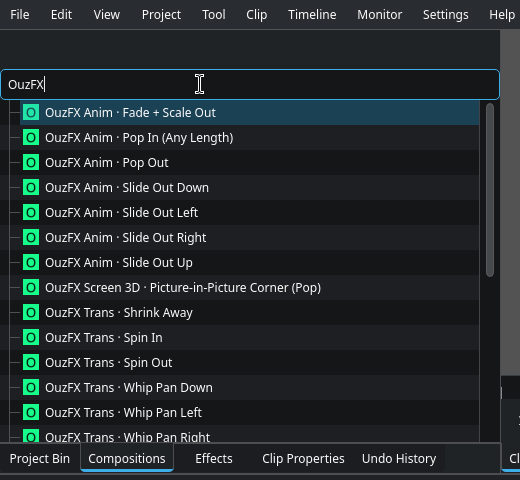

## Install

### Linux (Arch, Debian/Ubuntu, Fedora…, native package, AppImage or Flatpak)

```bash
git clone https://github.com/AlfaPigeon/kdenlive-fx-pack.git && cd kdenlive-fx-pack && ./install.sh
```

or without git:

```bash
curl -L https://github.com/AlfaPigeon/kdenlive-fx-pack/archive/refs/heads/main.tar.gz | tar xz && kdenlive-fx-pack-main/install.sh
```

`install.sh` auto-detects native and Flatpak Kdenlive and installs into whichever exists:

| Kdenlive build | Data folder used |
|---|---|
| distro package / AppImage / self-built | `~/.local/share/kdenlive/` (`$XDG_DATA_HOME/kdenlive`) |
| Flatpak (`org.kde.kdenlive`) | `~/.var/app/org.kde.kdenlive/data/kdenlive/` |

Options: `--profile 1080p|4k|vertical` (match your project resolution, default 1080p), `--native`, `--flatpak`, `--both`,
`--list`, `--uninstall`. **Restart Kdenlive** after installing.

```bash
./install.sh --profile 4k        # 3840×2160 projects
./install.sh --profile vertical  # 1080×1920 Shorts / Reels / TikTok projects
./install.sh --uninstall         # remove everything (uses the install manifest)
```

### Windows

Download the release zip, extract it, then in PowerShell:

```powershell
powershell -ExecutionPolicy Bypass -File .\install.ps1            # or -Profile 4k / -Profile vertical
powershell -ExecutionPolicy Bypass -File .\install.ps1 -Uninstall
```

Manual copy: `pack\<profile>\effect-templates\*.xml` → `%AppData%\kdenlive\effect-templates\`,
`pack\<profile>\transitions\*.xml` → `%AppData%\kdenlive\transitions\` (replace `@LUMADIR@` with your lumas path),
`pack\lumas\HD\ouzfx` → `%LocalAppData%\kdenlive\lumas\HD\ouzfx`.

### Manual / any OS

| What | Copy from | Copy to (`<data>` = folder from the table above) |
|---|---|---|
| Effect templates | `pack/<profile>/effect-templates/*.xml` | `<data>/effect-templates/` |
| Compositions | `pack/<profile>/transitions/*.xml` (replace `@LUMADIR@` with `<data>/lumas`) | `<data>/transitions/` |
| Luma wipes | `pack/lumas/HD/ouzfx/`, `pack/lumas/VERTICAL/ouzfx/` | `<data>/lumas/HD/ouzfx/`, `<data>/lumas/VERTICAL/ouzfx/` |

### KDE Store / "Download New Effects"

Release assets include KDE-Store-ready archives (`ouzfx-effect-templates-*.tar.gz` for the *Kdenlive Effect Templates*
category and `ouzfx-luma-wipes-hd-*.tar.gz` for *Kdenlive FX* (lumas)). Once published there they can be installed from inside
Kdenlive via **Effects ▸ Download New Effects** / the Wipe method **Download** button. See [docs/KDE_STORE.md](docs/KDE_STORE.md).

## Requirements

* **Kdenlive 24.08 or newer** (easing keyframe types such as back/elastic/bounce). Kdenlive 25.04+ recommended.
* **Kdenlive 25.04+** for the *Perspective Screen* presets (they use the Drop Shadow effect added in 25.04;
  older Kdenlive silently hides those six templates).
* Uses only effects that ship with Kdenlive: Transform (qtblend), Box Blur, Directional Blur, Gaussian Blur, Brightness,
  Crop/Rounded corners (qtcrop), Corners (frei0r), Drop Shadow, RGB Shift, Chroma Shift, Glitch0r, Scanlines, Grain,
  Dust, Colorize, Glow, Saturation, Greyscale, Vignette. frei0r-based presets need the **frei0r-plugins** package, which
  Kdenlive depends on in Arch (`frei0r-plugins`), Debian/Ubuntu, Flatpak and the AppImage/Windows builds.

## How to use

* **Effect templates** (Effects ▸ Templates, or search `OuzFX`): drag onto a clip. Keyframes are anchored to the **start of
  the clip**, so razor (`Shift+R`) where the hit should happen and drop the preset on the right-hand piece. Each template
  lands as a small, editable effect stack (e.g. Transform + Box Blur) – tweak strength in the Effect Stack.
  Lengths are in frames (designed at 25/30 fps; at 50/60 fps everything is twice as snappy).
* **Compositions** (Compositions panel, search `OuzFX`): put the clip on V2 above the clip it should reveal, then drag the
  composition onto the overlap. Their keyframes use `0=` / `-1=` so they always span the whole composition – make it
  6–12 frames for whips and zoom-throughs, seconds for Ken Burns.
* **Luma wipes**: any Wipe composition or same-track mix (select two adjacent clips ▸ `U`) ▸ *Wipe Method* ▸ `ouzfx_*`.
* **Resolution**: Kdenlive's Transform widget only round-trips pixel rectangles (percentage rects are mis-read by the UI),
  so effect templates and compositions are generated per resolution – install the profile matching your project
  (`--profile 1080p|4k|vertical`). Durations/easing are identical across profiles.

## Fast-paced editing kit ⚡

Research summary (sources below) – what makes MrBeast / Ali Abdaal / tech-YouTube / TikTok edits feel fast, and the matching preset:

| Technique | Why it works | OuzFX preset |
|---|---|---|
| Zoom punch on the beat (100→115-130 %, ease-out) | hides jump cuts, adds rhythm | `Zoom · Punch-In 115%`, `Zoom · Punch In-Out (Beat)`, `Fast · Beat Pulse ×4` |
| "Zoom cut" wide→close (MrBeast) | instant reframing without new footage | `Fast · Zoom Cut (Hard 130%)` |
| Boom zoom / smash cut | emphasis on reveals and punchlines | `Zoom · Boom Zoom`, `Fast · Smash Cut In`, `Fast · Rush Zoom` |
| Shake on impact (a few frames, peak on the beat) | physical "hit" feeling | `Shake · Heavy Impact`, `Fast · Impact Hit`, `Text · Text Slam` |
| 1–2 frame white/black flash | masks a cut, resets the eye | `Stylize · Flash Frame (White)`, `Stylize · Dip Flash (Black)` |
| Whip pan / motion-blur slide (match direction) | seamless energetic scene change | `Trans · Whip Pan *`, `Anim · Whip-In`, `Fast · Motion-Blur Push Left` |
| RGB split / glitch hit | digital energy on drops | `Stylize · RGB Split Hit`, `Stylize · Digital Glitch Burst`, `Wipe · Glitch Blocks` |
| Freeze frame + pop | call out a moment ("this guy…") | `Fast · Freeze-Frame Pop` + Kdenlive freeze |
| Stress colour (MrBeast red moment) | emotional emphasis | `Stylize · Red Moment` |
| Text pop / kinetic typography | on-screen keywords on the exact line | `Text · Text Pop`, `Text Rise`, `Text Slam`, `Highlight Flash` |
| Screen-recording zoom to cursor | readable tutorials / code | `Screen Zoom · Zoom to …`, `Zoom Back Out` |
| Film burn / light leak | warm transition between segments | `Stylize · Film Burn Flash`, `Wipe · Film Burn Wipe`, `overlays/` clips |
| Speed ramps | slow-mo on the hit, fast through the build-up | Kdenlive **Time Remap** (Clip ▸ Time Remap): add 2 keyframes, drag the speed handle; pair with `Rush Zoom` |
| J / L cuts | audio leads/trails the picture – smoother talking-head cuts | split audio (`Ungroup` or `Alt`-drag), trim the audio clip past the video cut – no effect needed |

Rules of thumb from the sources: land every move on the beat, keep hits to a few frames, use one or two transition styles
per video, default to the hard cut, and remember retention comes from new information, not effects alone.


## The presets

⚡ = part of the fast-paced kit

### Fast-Paced

| Preview | Name (search in Kdenlive) | What it does | Length |
|---|---|---|---|
|  | **OuzFX Fast · Impact Hit (Shake + Flash + Zoom)** ⚡<br><sub>`ouzfx_fast_impact_hit` · effect template</sub> | All-in-one hit: 2-frame flash, 125% punch and a decaying shake (12 frames). Use on beat drops. | 12 f |
| 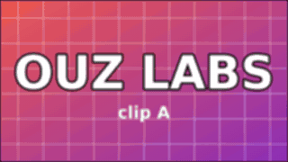 | **OuzFX Fast · Smash Cut In** ⚡<br><sub>`ouzfx_fast_smash_cut` · effect template</sub> | Starts at 140% with blur and slams to 100% in 4 frames – energetic hard cut entry. | 4 f |
| 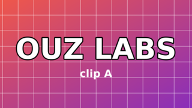 | **OuzFX Fast · Zoom Cut (Hard 130%)** ⚡<br><sub>`ouzfx_fast_zoom_cut_hold` · effect template</sub> | Instant 130% reframe, no animation – the MrBeast wide→close 'zoom cut'. | static |
|  | **OuzFX Fast · Beat Pulse ×4** ⚡<br><sub>`ouzfx_fast_beat_pulse` · effect template</sub> | Four quick 108% pulses, one every 12 frames (≈120 BPM at 24 fps). Stretch keyframes to your tempo. | 48 f |
| 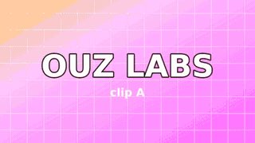 | **OuzFX Fast · Stutter Strobe** ⚡<br><sub>`ouzfx_fast_stutter_strobe` · effect template</sub> | 6-frame on/off brightness strobe – for glitchy, aggressive moments. | 6 f |
| 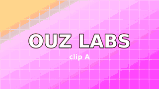 | **OuzFX Fast · Freeze-Frame Pop** ⚡<br><sub>`ouzfx_fast_freeze_pop` · effect template</sub> | Pair with Kdenlive's freeze (Timeline ▸ Insert Freeze Frame / Freeze effect): saturation boost, slight zoom and white flash so the still frame 'pops'. | 6 f |
| 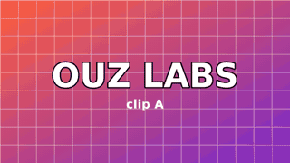 | **OuzFX Fast · Motion-Blur Push Left** ⚡<br><sub>`ouzfx_fast_motion_slide_l` · effect template</sub> | Last 6 frames of a clip: whips the picture out to the left with heavy blur. Pair with 'Whip-In' on the next clip. | 6 f |
|  | **OuzFX Fast · Rush Zoom** ⚡<br><sub>`ouzfx_fast_speed_lines_zoom` · effect template</sub> | Accelerating zoom (100→160%) with growing blur over 8 frames – cut on the last frame. | 8 f |

### Camera Shake

| Preview | Name (search in Kdenlive) | What it does | Length |
|---|---|---|---|
| 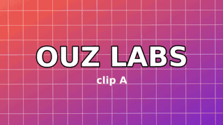 | **OuzFX Shake · Handheld · Light**<br><sub>`ouzfx_shake_handheld_light` · effect template</sub> | Subtle, smooth handheld drift for 10 s (loopable feel). Great on static talking-head or screen footage. Trim/extend: keyframes stop at clip end. | 250 f |
| 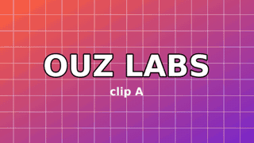 | **OuzFX Shake · Micro Jitter**<br><sub>`ouzfx_shake_micro_jitter` · effect template</sub> | Barely-there high-frequency jitter (10 s) that makes locked-off shots feel alive. | 250 f |
| 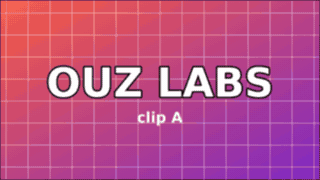 | **OuzFX Shake · Heavy Impact** ⚡<br><sub>`ouzfx_shake_heavy_impact` · effect template</sub> | 20-frame violent hit that decays to rest, with motion blur on the first frames. Put the clip start on the impact / beat drop. | 20 f |
| 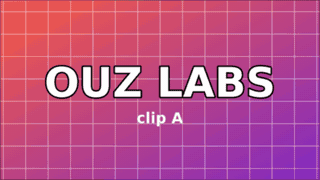 | **OuzFX Shake · Earthquake**<br><sub>`ouzfx_shake_earthquake` · effect template</sub> | 3 s of strong rumbling shake that slowly calms down, with light blur. | 75 f |
| 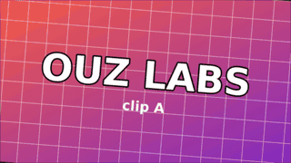 | **OuzFX Shake · Rotational**<br><sub>`ouzfx_shake_rotational` · effect template</sub> | Rocking rotational shake (30 frames, decaying) – feels like a punch to the camera. | 30 f |
| 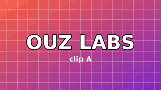 | **OuzFX Shake · Walking Bounce**<br><sub>`ouzfx_shake_walk_bounce` · effect template</sub> | Vertical bob of a walking camera operator (10 s loop). | 240 f |

### Dynamic Zoom

| Preview | Name (search in Kdenlive) | What it does | Length |
|---|---|---|---|
|  | **OuzFX Zoom · Punch-In 115%** ⚡<br><sub>`ouzfx_zoom_punch_in` · effect template</sub> | Snaps to 115% in 3 frames and holds – the classic jump-cut cover. | 3 f |
| 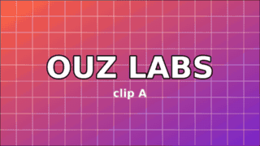 | **OuzFX Zoom · Punch In-Out (Beat)** ⚡<br><sub>`ouzfx_zoom_punch_in_out` · effect template</sub> | Zooms to 120% on frame 2 and settles back by frame 10. Drop one on every beat. | 10 f |
| 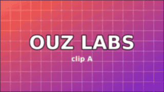 | **OuzFX Zoom · Boom Zoom** ⚡<br><sub>`ouzfx_zoom_boom` · effect template</sub> | Explosive 135% zoom with elastic settle at 112% (18 frames) – 'boom' moments. | 18 f |
|  | **OuzFX Zoom · Zoom Bounce**<br><sub>`ouzfx_zoom_bounce` · effect template</sub> | Zooms from 100% to 125% with a bouncy landing (20 frames). | 20 f |
| 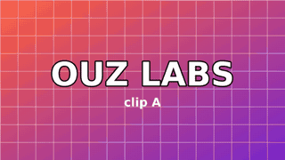 | **OuzFX Zoom · Slow Push-In (5 s)**<br><sub>`ouzfx_zoom_ken_burns_in` · effect template</sub> | Ken Burns style 100→112% push over 5 s (use the composition version to fit any length). | 125 f |
|  | **OuzFX Zoom · Slow Pull-Out (5 s)**<br><sub>`ouzfx_zoom_ken_burns_out` · effect template</sub> | Ken Burns style 112→100% pull-back over 5 s. | 125 f |

| Preview | Name (search in Kdenlive) | What it does | Length |
|---|---|---|---|
| 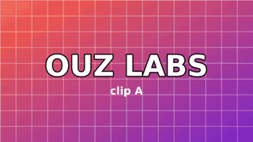 | **OuzFX Zoom · Ken Burns Push-In (Any Length)**<br><sub>`ouzfx_comp_ken_burns_in` · composition</sub> | 100→115% slow push that always spans the whole composition – stretch it over a photo/clip. | stretches |
|  | **OuzFX Zoom · Ken Burns Pull-Out (Any Length)**<br><sub>`ouzfx_comp_ken_burns_out` · composition</sub> | 115→100% slow pull-back spanning the composition. | stretches |
| 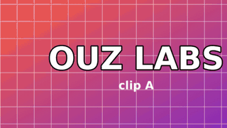 | **OuzFX Zoom · Ken Burns Pan L→R (Any Length)**<br><sub>`ouzfx_comp_ken_burns_pan` · composition</sub> | Pans across a 120% image from left to right over the composition length. | stretches |

### Screen Zoom

| Preview | Name (search in Kdenlive) | What it does | Length |
|---|---|---|---|
|  | **OuzFX Screen Zoom · Zoom to Top-Left (Screen Rec)** ⚡<br><sub>`ouzfx_zoom_screen_tl` · effect template</sub> | Smooth 15-frame zoom to 180% on the top-left of a screen recording, then holds. Razor the clip where you want to zoom; move the rectangle in the monitor to aim at the cursor. | 15 f |
| 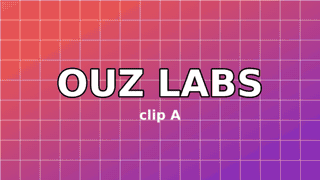 | **OuzFX Screen Zoom · Zoom to Top-Right (Screen Rec)** ⚡<br><sub>`ouzfx_zoom_screen_tr` · effect template</sub> | Smooth 15-frame zoom to 180% on the top-right of a screen recording, then holds. Razor the clip where you want to zoom; move the rectangle in the monitor to aim at the cursor. | 15 f |
| 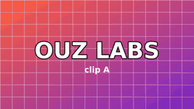 | **OuzFX Screen Zoom · Zoom to Bottom-Left (Screen Rec)** ⚡<br><sub>`ouzfx_zoom_screen_bl` · effect template</sub> | Smooth 15-frame zoom to 180% on the bottom-left of a screen recording, then holds. Razor the clip where you want to zoom; move the rectangle in the monitor to aim at the cursor. | 15 f |
|  | **OuzFX Screen Zoom · Zoom to Bottom-Right (Screen Rec)** ⚡<br><sub>`ouzfx_zoom_screen_br` · effect template</sub> | Smooth 15-frame zoom to 180% on the bottom-right of a screen recording, then holds. Razor the clip where you want to zoom; move the rectangle in the monitor to aim at the cursor. | 15 f |
|  | **OuzFX Screen Zoom · Zoom to Center (Screen Rec)** ⚡<br><sub>`ouzfx_zoom_screen_c` · effect template</sub> | Smooth 15-frame zoom to 180% on the center of a screen recording, then holds. Razor the clip where you want to zoom; move the rectangle in the monitor to aim at the cursor. | 15 f |
|  | **OuzFX Screen Zoom · Zoom Back Out (Screen Rec)**<br><sub>`ouzfx_zoom_screen_out` · effect template</sub> | Companion to the screen zooms: from 180% (center) back to full frame in 15 frames. | 15 f |

### Animations

| Preview | Name (search in Kdenlive) | What it does | Length |
|---|---|---|---|
|  | **OuzFX Anim · Pop-In**<br><sub>`ouzfx_anim_pop_in` · effect template</sub> | Scales from 0 to 100% with a back-overshoot in 12 frames. | 12 f |
|  | **OuzFX Anim · Slide In from Left**<br><sub>`ouzfx_anim_slide_in_left` · effect template</sub> | Slides in from the left edge in 12 frames (expo ease-out) with directional motion blur. | 12 f |
| 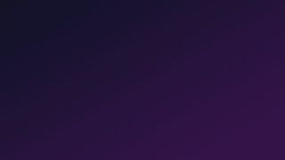 | **OuzFX Anim · Slide In from Right**<br><sub>`ouzfx_anim_slide_in_right` · effect template</sub> | Slides in from the right edge in 12 frames (expo ease-out) with directional motion blur. | 12 f |
| 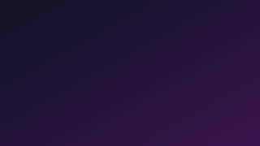 | **OuzFX Anim · Slide In from Top**<br><sub>`ouzfx_anim_slide_in_top` · effect template</sub> | Slides in from the top edge in 12 frames (expo ease-out) with directional motion blur. | 12 f |
| 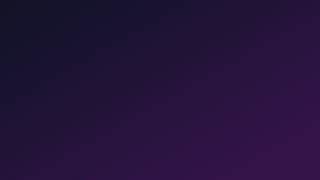 | **OuzFX Anim · Slide In from Bottom**<br><sub>`ouzfx_anim_slide_in_bottom` · effect template</sub> | Slides in from the bottom edge in 12 frames (expo ease-out) with directional motion blur. | 12 f |
|  | **OuzFX Anim · Bounce In (Drop)**<br><sub>`ouzfx_anim_bounce_in` · effect template</sub> | Drops from above and bounces on the floor (20 frames). | 20 f |
| 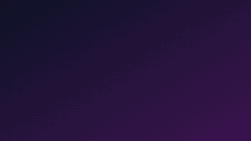 | **OuzFX Anim · Spin-In**<br><sub>`ouzfx_anim_spin_in` · effect template</sub> | Spins 360° while scaling from 0 to 100% (15 frames, cubic ease-out). | 15 f |
|  | **OuzFX Anim · Fade + Scale In**<br><sub>`ouzfx_anim_fade_scale_in` · effect template</sub> | Gentle 92→100% scale with fade-in over 15 frames – clean Apple-style reveal. | 15 f |
|  | **OuzFX Anim · Whip-In** ⚡<br><sub>`ouzfx_anim_whip_in` · effect template</sub> | Very fast slide from the right with heavy motion blur (6 frames). | 6 f |
|  | **OuzFX Anim · Elastic Zoom-In**<br><sub>`ouzfx_anim_elastic_in` · effect template</sub> | Springs in from 40% to 100% with an elastic wobble (20 frames). | 20 f |
| 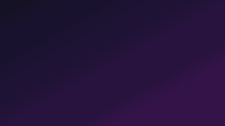 | **OuzFX Anim · Blur-In**<br><sub>`ouzfx_anim_blur_in` · effect template</sub> | Starts heavily blurred and transparent, resolves to sharp in 15 frames. | 15 f |

| Preview | Name (search in Kdenlive) | What it does | Length |
|---|---|---|---|
|  | **OuzFX Anim · Slide Out Left**<br><sub>`ouzfx_comp_slide_out_left` · composition</sub> | Top clip exits to the left (expo ease-in). Place it over the END of the clip. | stretches |
|  | **OuzFX Anim · Slide Out Right**<br><sub>`ouzfx_comp_slide_out_right` · composition</sub> | Top clip exits to the right (expo ease-in). Place it over the END of the clip. | stretches |
| 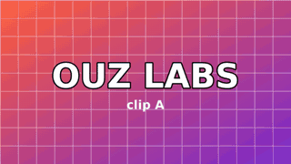 | **OuzFX Anim · Slide Out Up**<br><sub>`ouzfx_comp_slide_out_up` · composition</sub> | Top clip exits to the up (expo ease-in). Place it over the END of the clip. | stretches |
|  | **OuzFX Anim · Slide Out Down**<br><sub>`ouzfx_comp_slide_out_down` · composition</sub> | Top clip exits to the down (expo ease-in). Place it over the END of the clip. | stretches |
|  | **OuzFX Anim · Pop Out**<br><sub>`ouzfx_comp_pop_out` · composition</sub> | Anticipates (grows to 106%) then collapses to 0% – place over the end of a clip/title. | stretches |
|  | **OuzFX Anim · Fade + Scale Out**<br><sub>`ouzfx_comp_fade_scale_out` · composition</sub> | Soft 100→92% shrink with fade-out. | stretches |
|  | **OuzFX Anim · Pop In (Any Length)**<br><sub>`ouzfx_comp_pop_in` · composition</sub> | Back-overshoot pop-in that stretches to the composition length. | stretches |

### Perspective Screen

| Preview | Name (search in Kdenlive) | What it does | Length |
|---|---|---|---|
|  | **OuzFX Screen 3D · Tilt Left**<br><sub>`ouzfx_screen_tilt_left` · effect template</sub> | Screen recording turned into a 3D panel facing left: rounded corners, perspective and a soft drop shadow. Put a background on the track below. | static |
| 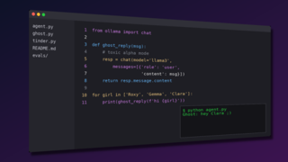 | **OuzFX Screen 3D · Tilt Right**<br><sub>`ouzfx_screen_tilt_right` · effect template</sub> | Mirror of Tilt Left – panel facing right. | static |
|  | **OuzFX Screen 3D · Laptop Lean**<br><sub>`ouzfx_screen_tilt_back` · effect template</sub> | Panel leaning back like a laptop screen seen from the desk. | static |
|  | **OuzFX Screen 3D · Floating Screen (Flat)**<br><sub>`ouzfx_screen_floating` · effect template</sub> | Flat floating window: rounded corners, 82% scale, big soft shadow. | static |
| 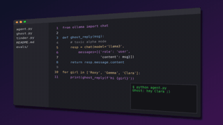 | **OuzFX Screen 3D · Swing to Front**<br><sub>`ouzfx_screen_tilt_to_flat` · effect template</sub> | Starts tilted left and swings to a flat, centred panel in 25 frames – nice opener for a demo. | 25 f |
| 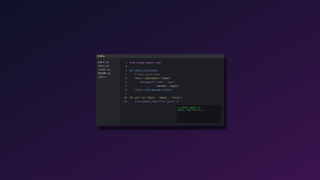 | **OuzFX Screen 3D · Floating Screen · Pop In**<br><sub>`ouzfx_screen_pop_in` · effect template</sub> | Floating window pops in from 40% with overshoot (18 frames), rounded + shadow. | 18 f |

| Preview | Name (search in Kdenlive) | What it does | Length |
|---|---|---|---|
| 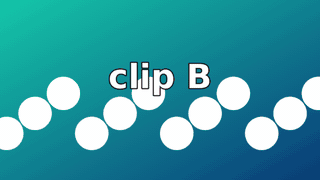 | **OuzFX Screen 3D · Picture-in-Picture Corner (Pop)**<br><sub>`ouzfx_comp_picture_in_picture` · composition</sub> | Webcam/facecam bubble: pops into the bottom-right corner at 30% size. | stretches |

### Transitions

| Preview | Name (search in Kdenlive) | What it does | Length |
|---|---|---|---|
| 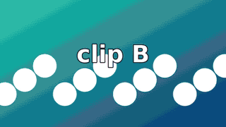 | **OuzFX Trans · Zoom-Through In** ⚡<br><sub>`ouzfx_comp_zoom_through_in` · composition</sub> | Top clip flies in from 300% (transparent) to full frame – put it over the end of the lower clip. | stretches |
| 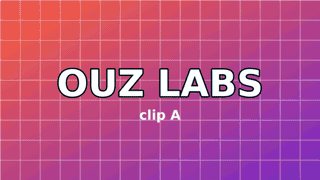 | **OuzFX Trans · Zoom-Through Out** ⚡<br><sub>`ouzfx_comp_zoom_through_out` · composition</sub> | Top clip rushes towards the camera (100→300%) and fades, revealing the clip below. | stretches |
|  | **OuzFX Trans · Shrink Away**<br><sub>`ouzfx_comp_zoom_out_reveal` · composition</sub> | Top clip shrinks to nothing in the centre, revealing the lower track. | stretches |
|  | **OuzFX Trans · Whip Pan Left** ⚡<br><sub>`ouzfx_comp_whip_left` · composition</sub> | Top clip enters from the opposite side and whips left into place with strong ease-out (add a dblur/boxblur for extra smear). Keep it 6–10 frames. | stretches |
|  | **OuzFX Trans · Whip Pan Right** ⚡<br><sub>`ouzfx_comp_whip_right` · composition</sub> | Top clip enters from the opposite side and whips right into place with strong ease-out (add a dblur/boxblur for extra smear). Keep it 6–10 frames. | stretches |
| 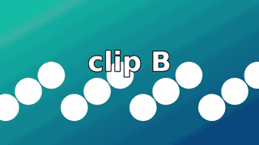 | **OuzFX Trans · Whip Pan Up** ⚡<br><sub>`ouzfx_comp_whip_up` · composition</sub> | Top clip enters from the opposite side and whips up into place with strong ease-out (add a dblur/boxblur for extra smear). Keep it 6–10 frames. | stretches |
|  | **OuzFX Trans · Whip Pan Down** ⚡<br><sub>`ouzfx_comp_whip_down` · composition</sub> | Top clip enters from the opposite side and whips down into place with strong ease-out (add a dblur/boxblur for extra smear). Keep it 6–10 frames. | stretches |
|  | **OuzFX Trans · Spin In** ⚡<br><sub>`ouzfx_comp_spin_in` · composition</sub> | Top clip spins in 360° from 0% – fun, high-energy reveal. | stretches |
| 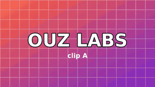 | **OuzFX Trans · Spin Out**<br><sub>`ouzfx_comp_spin_out` · composition</sub> | Top clip spins away 360° shrinking to 0%. | stretches |

### Glitch & Stylize

| Preview | Name (search in Kdenlive) | What it does | Length |
|---|---|---|---|
|  | **OuzFX Stylize · RGB Split Hit** ⚡<br><sub>`ouzfx_glitch_rgb_split_hit` · effect template</sub> | 8-frame chromatic split that kicks hard and snaps back – sync to a beat or a cut. | 8 f |
| 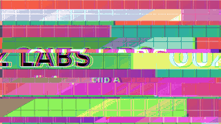 | **OuzFX Stylize · Digital Glitch Burst** ⚡<br><sub>`ouzfx_glitch_digital_burst` · effect template</sub> | 12 frames of block glitching + RGB tearing that fades out. | 12 f |
|  | **OuzFX Stylize · VHS Tape**<br><sub>`ouzfx_style_vhs` · effect template</sub> | Scanlines, chroma bleed, soft blur, noise and slightly washed colour – instant 90s tape. | static |
| 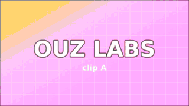 | **OuzFX Stylize · Flash Frame (White)** ⚡<br><sub>`ouzfx_flash_white` · effect template</sub> | 2-frame white flash that fades by frame 6 – hides a cut and adds punch. | 6 f |
| 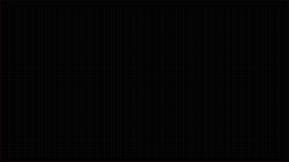 | **OuzFX Stylize · Dip Flash (Black)** ⚡<br><sub>`ouzfx_flash_black` · effect template</sub> | Quick dip to black and back in 6 frames. | 6 f |
| 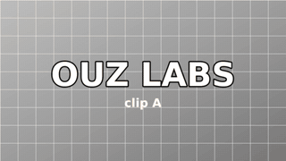 | **OuzFX Stylize · Film Burn Flash** ⚡<br><sub>`ouzfx_style_film_burn` · effect template</sub> | Warm orange over-exposure with glow that peaks at frame 6 and clears by 16. | 16 f |
|  | **OuzFX Stylize · Warm Light Leak Look**<br><sub>`ouzfx_style_light_leak` · effect template</sub> | Soft warm glow and lifted highlights (static look). For moving leaks, also drop overlays/ouzfx_light_leak.mp4 on a track above with Screen blend. | static |
|  | **OuzFX Stylize · Red Moment** ⚡<br><sub>`ouzfx_style_red_alert` · effect template</sub> | MrBeast-style 'stress' tint: flash to deep red with a small punch (hold 1–2 s). | 4 f |
| 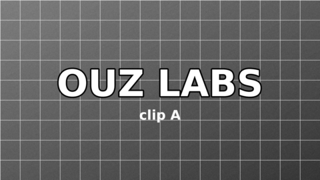 | **OuzFX Stylize · B&W Flashback**<br><sub>`ouzfx_style_flashback` · effect template</sub> | Black & white, grain, vignette and old-film flicker for flashbacks / archive footage. | static |

### Text & Titles

| Preview | Name (search in Kdenlive) | What it does | Length |
|---|---|---|---|
|  | **OuzFX Text · Text Pop** ⚡<br><sub>`ouzfx_text_pop` · effect template</sub> | For title clips: pops in with a back overshoot in 8 frames (kinetic typography staple). | 8 f |
|  | **OuzFX Text · Text Slam** ⚡<br><sub>`ouzfx_text_slam` · effect template</sub> | Title slams down from 300% and the frame shakes on landing (14 frames). | 14 f |
|  | **OuzFX Text · Text Rise**<br><sub>`ouzfx_text_rise` · effect template</sub> | Rises 6% and fades in over 12 frames – clean lower-third / callout entry. | 12 f |
| 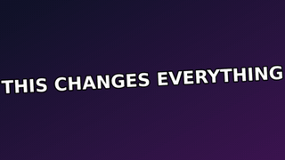 | **OuzFX Text · Text Wiggle (Loop)**<br><sub>`ouzfx_text_wiggle` · effect template</sub> | Playful ±3° wiggle and 2% breathe for 4 s – for stickers, arrows, emojis. | 100 f |
|  | **OuzFX Text · Highlight Flash**<br><sub>`ouzfx_text_typewriter_flash` · effect template</sub> | Draws attention to a callout: brightness flash + 110% pulse (10 frames). | 10 f |

### Overlays

| Preview | Name (search in Kdenlive) | What it does | Length |
|---|---|---|---|
|  | **OuzFX Look · Cinematic 2.39:1 Bars + Vignette**<br><sub>`ouzfx_look_cinematic_239` · effect template</sub> | Letterbox bars for a 2.39:1 look plus a soft vignette. | static |
|  | **OuzFX Look · Cinematic Bars Slide-In**<br><sub>`ouzfx_look_bars_slide_in` · effect template</sub> | 2.39:1 letterbox bars glide in over 15 frames – 'movie moment' / dramatic beat. | 15 f |
|  | **OuzFX Look · Film Grain + Dust**<br><sub>`ouzfx_look_film_grain` · effect template</sub> | Organic grain with a few dust specks – makes digital footage feel shot on film. | static |
| 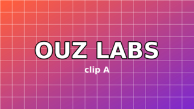 | **OuzFX Look · Soft Vignette**<br><sub>`ouzfx_look_soft_vignette` · effect template</sub> | Gentle edge darkening that pulls the eye to the centre. | static |

### Luma Wipes

| Preview | Name (search in Kdenlive) | What it does | Length |
|---|---|---|---|
| 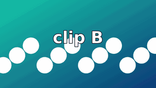 | **OuzFX Wipe · Film Burn Wipe**<br><sub>`ouzfx_comp_wipe_burn` · composition</sub> | Wipe composition using the bundled ouzfx_burn.png luma (softness 0.25). The same luma is also selectable in every Wipe/Luma transition and same-track mix. | stretches |
| 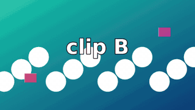 | **OuzFX Wipe · Glitch Blocks Wipe** ⚡<br><sub>`ouzfx_comp_wipe_glitch` · composition</sub> | Wipe composition using the bundled ouzfx_glitch_blocks.png luma (softness 0.0). The same luma is also selectable in every Wipe/Luma transition and same-track mix. | stretches |
|  | **OuzFX Wipe · Diamond Wipe**<br><sub>`ouzfx_comp_wipe_diamond` · composition</sub> | Wipe composition using the bundled ouzfx_diamond.png luma (softness 0.08). The same luma is also selectable in every Wipe/Luma transition and same-track mix. | stretches |
|  | **OuzFX Wipe · Clock Wipe**<br><sub>`ouzfx_comp_wipe_clock` · composition</sub> | Wipe composition using the bundled ouzfx_clock.png luma (softness 0.04). The same luma is also selectable in every Wipe/Luma transition and same-track mix. | stretches |
|  | **OuzFX Wipe · Iris Wipe**<br><sub>`ouzfx_comp_wipe_iris` · composition</sub> | Wipe composition using the bundled ouzfx_radial.png luma (softness 0.1). The same luma is also selectable in every Wipe/Luma transition and same-track mix. | stretches |

### Luma wipe images

| Preview | File | Shape |
|---|---|---|
|  | `ouzfx_radial.png` | Iris / radial from centre |
|  | `ouzfx_radial_soft.png` | Soft round spotlight |
|  | `ouzfx_diagonal_tl.png` | Diagonal from top-left |
|  | `ouzfx_diagonal_tr.png` | Diagonal from top-right |
|  | `ouzfx_clock.png` | Clock sweep from 12 o'clock |
| 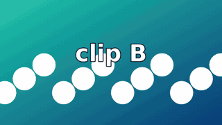 | `ouzfx_blinds_h.png` | Horizontal blinds (8 slats) |
|  | `ouzfx_blinds_v.png` | Vertical blinds (12 slats) |
|  | `ouzfx_diamond.png` | Diamond from centre |
|  | `ouzfx_burn.png` | Organic film-burn noise |
|  | `ouzfx_glitch_blocks.png` | Random glitch blocks |
|  | `ouzfx_zigzag.png` | Zig-zag teeth from left |
|  | `ouzfx_barn_doors.png` | Barn doors opening from centre |
|  | `ouzfx_spiral.png` | Spiral from centre |
|  | `ouzfx_heart.png` | Heart iris (for fun edits) |
|  | `ouzfx_pixel_dissolve.png` | Pixel dissolve (32px cells) |
|  | `ouzfx_swipe_up_soft.png` | Soft swipe upwards |


### Overlay clips (`overlays/`, installed to `<data>/ouzfx/overlays/`)

| File | Use |
|---|---|
| `ouzfx_light_leak.mp4` | 4 s warm light leak – put on a track above, Composition ▸ *Composite and transform* ▸ Compositing: **Screen** |
| `ouzfx_film_burn.mp4` | 1.6 s film-burn flash for segment transitions (Screen / Plus) |

## Building & testing

Everything is generated from [`tools/presets.py`](tools/presets.py):

```bash
python3 tools/build.py                    # writes pack/ (3 resolutions), lumas, catalog
python3 tools/validate.py /usr/share/kdenlive   # schema check vs. Kdenlive's own effect definitions
python3 tools/render_tests.py             # melt render of every preset + previews + docs/test-results.json
python3 tools/gen_readme.py && tools/package.sh   # README + release archives in dist/
```

Validation done for v1.0.0:

* `xmllint` + `validate.py` against Kdenlive **git master** effect definitions (all ids/params exist) and against Debian's
  Kdenlive 24.12 data (all OK except Drop Shadow, which is 25.04+ – documented above).
* Every effect template, composition and luma rendered through MLT 7.30 `melt` at 1920×1080 (filters/transitions parse,
  no errors, and the picture measurably changes): **102/102 passed** – see `docs/test-results.json`.
* Loaded in a real **Kdenlive 24.12.3** session (Xvfb): all templates appear under *Effects ▸ Templates*, all compositions
  in the *Compositions* panel; applied *Anim · Slide In from Left* to a trimmed clip and *Zoom · Ken Burns Push-In* as a
  composition and checked keyframes/monitor output ([screenshot](docs/screenshots/slide-in-mid-frame.png)).
* Keyframe/offset behaviour checked against Kdenlive's source (`EffectStackModel::fromXml`,
  `KeyframeModel::getAnimationStringWithOffset`, `KeyframeModelList::checkConsistency`, `EffectsRepository::parseCustomAssetFile`):
  all animated parameters of an effect share the same keyframe positions, so Kdenlive never has to "repair" them.

## Credits & sources

* Kdenlive formats: [Kdenlive source](https://invent.kde.org/multimedia/kdenlive) (`data/effects/templates`, `data/knewstuff/*.knsrc`,
  `src/effects/effectsrepository.cpp`), [Kdenlive 22.04 effect templates announcement](https://kdenlive.org/news/releases/22.04.0/),
  [Kdenlive 24.08 easing modes](https://kdenlive.org/news/releases/24.08.0/), [Effects manual](https://docs.kdenlive.org/en/effects_and_filters.html),
  [KDE Store category request T14146](https://phabricator.kde.org/T14146), [MLT keyframe/animation docs](https://www.mltframework.org/docs/propertyanimation/).
* Fast-paced editing research:
  [Inkroy – Best transitions for edits (shake, zoom, flash, blur)](https://inkroy.com/learn/best-capcut-transitions-for-edits),
  [CapCut jugg edit tutorial – shakes, zooms, glitch cuts](https://capcutguide.com/capcut-jugg-edit/),
  [Velocity edits / speed ramps guide](https://capecutapks.com/how-to-create-velocity-edits-in-capcut-a-step-by-step-guide-for-beginners-2026/),
  [Olaf Motion – Reels transitions: zoom, whip, glitch, shake, light leaks](https://olafmotion.com/explore/reels-transitions-after-effects/),
  [Increditors – Hormozi, Ali Abdaal & MrBeast editing styles](https://increditors.com/an-ultimate-guide-to-alex-hormozi-ali-abdaal-and-mr-beast-video-editing-style-and-methods/),
  [Moonshot – Ali Abdaal editing style](https://makemoonshot.co/blog/ali-abdaal-editing-style),
  [SambaraVid – Ali Abdaal podcast editing (J/L cuts, whip pans)](https://sambaravid.com/tips-to-edit-like-ali-abdaal-video-podcast/),
  [VideoHero – Learn from a MrBeast video](https://www.videohero.com/blog/MrBeast-and-video-editing),
  [Vidpros – Mario Joos on retention editing](https://vidpros.com/retention-editing-what-you-can-learn-from-mario-joos/).
* All presets, lumas, overlays and preview media are original work generated by the scripts in `tools/`.

## License

[MIT](LICENSE) © 2026 Oğuz Kaan Özsoy · Ouz Labs
